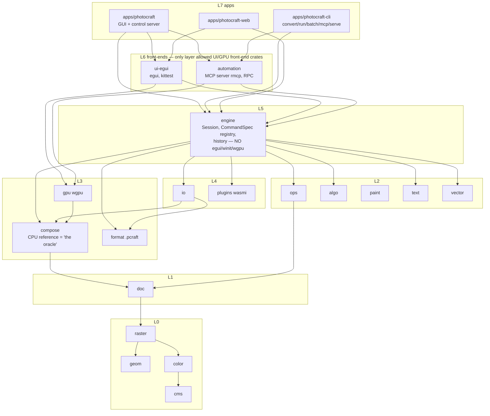
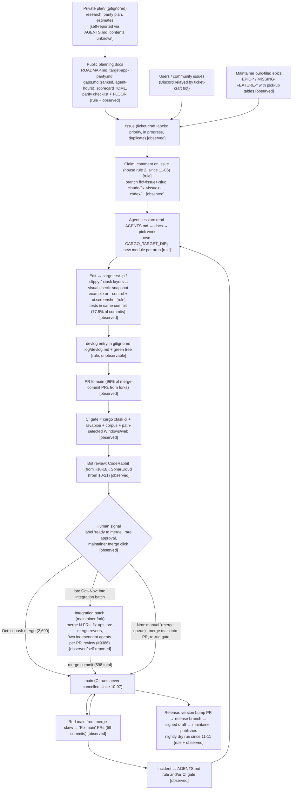

# 03 — Architecture and process reconstruction

Subject: `storytold/photocraft` ("PhotoCraft"), main pinned at `74330157cb` (2026-11-12).
Inputs: evidence files E01, E02, E03, E04, E05, E06, E07, E08 in this repo, plus spot checks in the
upstream clone (listed at the end). Every row carries a label: **VERIFIED** (seen in a primary
source and cited), **INFERRED** (reasoned from verified facts; the chain is given), **PROPOSED** (ours;
not a PhotoCraft practice). For process claims, a second tag says what kind of evidence it is:
*documented rule* (written in AGENTS.md/docs), *observed pattern* (seen in git or PR pages),
*self-reported* (a developer says so; not checked), *unknown*.

Terms used throughout:
- **AGENTS.md**: the single root agent-instruction file ("guide for AI agents and contributors",
  `HEAD:AGENTS.md:54`), 214 lines, 38 revisions (E02-002).
- **House rules**: two blocks (15 core rules plus 6 Rust rules) copied byte-for-byte from the org repo
  `storytold/craft-contrib` into `HEAD:AGENTS.md:1-52`, each with a sha256 in its header, checked by the
  `house-rules.yml` workflow (E02-012, E04-035).
- **Command registry**: the engine's table of `CommandSpec` entries; every user-visible action is one
  command with a string id and JSON params (E04-010).
- **Control channel**: a JSON protocol on a running app (`photocraft --control`) for inspecting UI state,
  injecting input and taking screenshots (`docs/control-protocol.md`, E04-013).
- **xtask**: the workspace's Rust task runner (`cargo xtask <cmd>`), 15 subcommands (E04-030).
- **`panic_hunt`**: an integration test that enumerates every registered command and fuzzes it with
  hostile params; a panic fails the gate (E04-012).
- **Scorecard**: `scorecard/*.toml` goal rows rendered by `cargo xtask scorecard` into `docs/scorecard.md`;
  CI fails if the rendered doc is stale (E04-050).
- **Parity checklist / FLOOR**: a generated list of the reference app's menu items and whether a command
  backs each; `FLOOR` is a constant the live count may never fall below (E01-015, E04-042).
- **Integration batch**: a branch that merges many open PRs, fixes the union, runs CI once, and is then
  either thrown away (members merged one by one) or merged as one merge commit (E06-021, E06-022).
- **Oracle**: an external source of "correct" output — here mainly Photoshop's own merged composite
  embedded in PSD files, and a CPU reference compositor for the GPU path (E04-036, E04-037).

Dates are 2026 unless stated. "Day 1" = 2026-09-30, the date of `16941f7198` ("one-shot").

---

## Summary of findings

1. **The agent-facing architecture was planned before code and landed in the first code commit.** The
   headless engine, the command registry, the control channel with `ui.screenshot`, the layer linter in
   CI and an AGENTS.md telling agents to "Launch the app with `--control`, drive it, take
   `ui.screenshot`, and look at the PNG" all exist in `16941f7198` (E04-020, E01-003). VERIFIED.
2. **Only four mechanisms are *documented* as aids for agents developing the product:** the
   screenshot/offscreen self-check, the ranked machine-readable work lists (scorecard, gaps.md, parity
   checklist), the per-agent target directory rules, and the mechanical gates named in AGENTS.md's
   "Before you finish" list. MCP, the CLI and `serve` are documented for agents *using* the product, not
   for agents building it (E04-018, E04-026). VERIFIED.
3. **Rules that matter became checks, usually after a failure.** `panic_hunt` ran in CI only after a commit
   noted nothing enforced the "must stay green" rule (45afd2e9d7); the GPU no-skip check came after 57 GPU
   tests "passed without comparing anything" (2ff8f419cb); "everything is a command" got a lexical
   scanner (4165c57f92). Rules with no check (licence allowlist, "no agent attribution", claim-before-coding)
   are the ones practice visibly diverges from (E02 §4, E05-071). VERIFIED.
4. **The process is a high-throughput, weak-review pipeline held together by gates and integrators.**
   ~3,285 PRs landed in 44 days (E03 §5); on 10 sampled PR pages, human approval appears once (#7848)
   and "No reviews" is common (E06-040/041, E05-035). From late October most community PRs reached main
   through maintainer-run integration batches; one batch PR states review was done by "two independent
   agents per PR (a reviewer and an attacker)" (#9386, via WebFetch summary). VERIFIED (sample) / INFERRED
   (generalisation).
5. **The orchestration layer is invisible.** No subagent, orchestration, worktree or tool-permission
   configuration exists on main; session memory lives in a gitignored `log/devlog.md`; the original plan
   lives in a gitignored `plan/` (E02 §6, E01-005). How many agents ran, how they were launched and how work
   was assigned is only self-reported ("8 parallel agents", "10–20 concurrent agents", E08-003/005).

---

# Part A — Architecture as it bears on agent development

## A.0 How to read the verdict columns

For each mechanism we give three answers:
- **Documented as aiding agent development?** — a primary doc tells a developer or agent to use it while
  building or testing PhotoCraft. Quoted when yes.
- **Observed used that way in history?** — commits, tests or PR pages show it used during development.
- **Only our hypothesis?** — the link to agent development is ours, not the project's.

Agent use counts only when explicitly attributed (trailer, identity, branch name, PR footer). Many
infrastructure commits (`16941f7198`, `0f955e6c82`, `968baf639e`) carry no trailer: their authorship
by an agent is *unknown* (E04 open questions).

## A.1 Dependency-layer diagram

Source: `xtask/src/layers.rs` TABLE (`HEAD:xtask/src/layers.rs:35-75`) and the direct-dependency scan in
E04-002. Every edge points downward; UI crates (`egui`, `eframe`, `winit`, `rfd`, …) are banned below
layer 6 (`HEAD:xtask/src/layers.rs:102`, `UI_MIN_LAYER = 6` at `:105`). VERIFIED.



Simplified: edges are a subset of E04-002's table; standalone crates (`codecs`, `affinity`, `raw`,
`ipp`, `tablet`) and the dev-only `testkit` are omitted. Note the deviation from the day-1 plan: the
engine does not depend on `gpu` at all, whereas the plan made `gpu` an optional default engine feature
(`16941f7198:docs/architecture.md`, still at `HEAD:docs/architecture.md:184`; E04-002). VERIFIED.

## A.2 "One command, four front-ends" diagram

Sources: `HEAD:crates/engine/src/cmd.rs:14-28` (struct), `HEAD:crates/engine/src/session/execute.rs:17`
(single dispatch), `HEAD:AGENTS.md:116` (rule 1), E04-011/012/016. VERIFIED.

```mermaid
flowchart LR
  subgraph Registry[engine: CommandSpec registry ~805 ids at HEAD, regex estimate]
    SPEC["CommandSpec { id, label, menu, shortcut,<br/>params: &'static str (JSON-ish doc),<br/>enabled, run: fn(&mut Session,&Value)->Result<Value>, journal }"]
  end
  EXEC["Session::execute(id, params: Value) -> Result<Value><br/>one history step per run; 'coalesce' param"]
  SPEC --> EXEC
  UI[GUI panels / menus<br/>ui-egui] -- "dispatch by id<br/>(checked by xtask panel-commands)" --> EXEC
  CLIF[CLI: photocraft-cli run / batch / serve] --> EXEC
  CTRL[Control channel: engine.execute,<br/>engine.commands, ui.* methods] --> EXEC
  MCP[MCP server: command_list / command_run<br/>+ 24 doc/ui/job tools] --> EXEC
  TEST[Tests: Session::new() + execute;<br/>panic_hunt enumerates command_specs()] --> EXEC
```

The fifth consumer, tests, is named by the architecture principle itself: "Every feature is reachable
without a GUI: from tests, the CLI and MCP. The GUI is one client of the engine."
(`16941f7198:docs/architecture.md:23`, unchanged at `HEAD:docs/architecture.md:52`; E04-008). VERIFIED.

## A.3 Mechanism by mechanism

### A.3.1 Headless engine

- **Exists:** VERIFIED. `crates/engine` has no egui, eframe, winit, wgpu or rfd dependency
  (`HEAD:crates/engine/Cargo.toml`; E04-007). The layer linter makes this a CI failure, not a convention
  (`HEAD:xtask/src/layers.rs:102`).
- **Since:** day 1, `16941f7198` (E04-005: `engine` among the 14 initial crates).
- **How it works:** a `Session` owns documents and history; all work goes through
  `Session::execute(id, params)` (`HEAD:crates/engine/src/session/execute.rs:17`) or the undoable
  `Session::edit` (`:232`). Tests construct `Session::new()` directly — 135 files under
  `crates/engine/tests` do so (E04-008). `photocraft-cli serve` keeps "one headless engine session … the
  fastest way for a script or agent to make many edits" (`HEAD:docs/control-protocol.md:473-490`), and MCP
  has a headless in-process mode with "no window" (`:383`; E04-009). The engine also compiles to wasm
  (`HEAD:AGENTS.md:122`, rule 7), checked by `cargo xtask wasm` in the gate.

| Documented as aiding agent dev? | Observed used that way? | Only our hypothesis? |
|---|---|---|
| Partly. The principle names **tests** as a client ("reachable without a GUI: from tests, the CLI and MCP", `HEAD:docs/architecture.md:52`). It never says "so that agents can develop it". | Yes for testing: 4,452 engine test attributes, tests drive `Session::new()` (E04-004, E04-008). Agent authorship of those tests is per-commit (unknown for many). | "Headless was chosen *to make agent development easier*" is our hypothesis. The documented reason is testability and multiple clients. |

### A.3.2 Layered workspace with CI-enforced dependency direction

- **Exists:** VERIFIED. 24 crates + 4 apps + xtask (`HEAD:Cargo.toml:3`; E04-001). `cargo xtask layers`
  parses `cargo metadata`, rejects upward edges, UI crates below L6, a non-dev use of `testkit`, and any
  crate not registered in the TABLE (`HEAD:xtask/src/layers.rs`, 396 lines, unit tests at `:266-380`;
  E04-031).
- **Since:** day 1, and in CI on day 1 (`16941f7198:.github/workflows/ci.yml:60-61`; E04-031).
- **How it works:** a static TABLE maps crate → layer; intra-layer order is allowed only for named pairs
  (`INTRA_LAYER_ORDER`, `:80`); `STANDALONE_EXCEPTIONS` is empty (`:93`). It runs inside
  `cargo xtask ci` and in the Windows integration leg (E04-030). AGENTS.md: "**Layering is enforced** by
  `cargo xtask layers`. A crate may depend only on lower layers. … A new crate must be registered in
  `xtask/src/layers.rs`." (`HEAD:AGENTS.md:77-99`; E02 §2.3).
- **Drift:** the TABLE still reserves never-built crates (`tools`, `viewport`, `ml`, `platform`,
  `adobe-assets`), and AGENTS.md §2 still lists `psd` after its removal in `74330157cb` (E04-006, E04-031).

| Documented as aiding agent dev? | Observed used that way? | Only our hypothesis? |
|---|---|---|
| Yes, as an instruction to agents: listed in "Before you finish a task" from day 1 (`16941f7198:AGENTS.md:49-54`) and at HEAD (`HEAD:AGENTS.md:145-160`). The *purpose* given is architecture integrity, not agent support. | Yes: blocking CI gate since day 1 (E04-031, E05 §0.2). | That it was designed because agents erode architecture is our hypothesis. |

### A.3.3 Single command registry (JSON in/out) feeding UI, CLI, control channel and MCP

- **Exists:** VERIFIED. `pub struct CommandSpec` (`HEAD:crates/engine/src/cmd.rs:15`) with `params:
  &'static str` described as a "Human/agent-readable parameter description (JSON-ish)" (`:22-23`) and
  `run: fn(&mut Session,&Value)->Result<Value>`. Same shape in the one-shot
  (`16941f7198:crates/engine/src/commands.rs:16-30`; E04-010).
- **Since:** day 1. ~76 command ids at `16941f7198`, ~805 at HEAD (regex upper-bound estimate, E04-010;
  docs say "~700", README "500+" — doc drift). Spread over 195 files in `crates/engine/src/cmd/`.
- **How it works:** one dispatch function, JSON value in and out, one history step per run
  (`HEAD:docs/contributing.md:18-22`). The params doc string "is what agents read through `commands` /
  `command_list`" (E04-011). MCP wraps the registry generically (`command_list`/`command_run`), so new
  commands reach MCP with no new tool code (E04-016). `panic_hunt` enumerates `command_specs()` and
  fuzzes each (`HEAD:crates/engine/tests/panic_hunt.rs:1-5`). AGENTS.md rule 1: "**Everything is a
  command.** … The UI, CLI, control channel and MCP all dispatch commands by id." (`HEAD:AGENTS.md:116`).
  AGENTS.md §6 tells parallel agents to put new commands in a **new module** with a `specs()` function
  "rather than growing a shared file" (`HEAD:AGENTS.md:173`).

| Documented as aiding agent dev? | Observed used that way? | Only our hypothesis? |
|---|---|---|
| Yes in two ways: (a) the params string is called "agent-readable" (`cmd.rs:22-23`); (b) the new-module-per-area rule is in the **Parallel agents** section (`HEAD:AGENTS.md:173`). | Yes: `panic_hunt` (added bf111b524e, Claude Opus 4.8 trailer) fuzzes every command in the CI gate (E04-012); conflict-avoidance via per-area modules is implied by 195 command files (count only). | That the registry shape *reduced merge conflicts between agents* is our INFERENCE from the §6 rule; not measured. |

### A.3.4 Control channel / CLI / MCP programmatic interfaces

- **Exists:** VERIFIED.
  - Control channel: 14 methods on day 1 (`engine.execute`, `engine.commands`, `ui.inspect`, `ui.set`,
    `ui.menu.*`, `ui.dialog.*`, `ui.pointer`, `ui.screenshot`, …; `16941f7198:docs/control-protocol.md:20-33`).
    At HEAD the doc is 840 lines with token/HMAC auth, jobs, an MCP bridge and a headless server
    (`HEAD:docs/control-protocol.md:11-40`, `:379`, `:473`; E04-013). Transport
    `apps/photocraft/src/control_server.rs`, handlers `crates/ui-egui/src/control.rs`.
  - Offscreen path: `crates/ui-egui/examples/snapshot.rs` replays "a JSON array of `[method, params]`
    control-protocol calls" with no window (since ae92ac20bf; E04-021).
  - CLI: 8 subcommands (`HEAD:apps/photocraft-cli/src/args.rs:33-40`; E04-014).
  - MCP: `crates/automation/src/server.rs`, 17 tools on day 1 (ae92ac20bf) → 26 at HEAD; bridge mode
    forwards to a live `photocraft --control` "so agents see and drive the live app"
    (`HEAD:docs/control-protocol.md:384`; E04-016/017).
- **Since:** control channel and CLI day 1 (`16941f7198`); MCP day 1 afternoon (`ae92ac20bf`); docs/mcp.md
  2026-10-09 (`15e35cf605`).
- **How it works for development:** AGENTS.md rule 6 at HEAD: "**Verify UI changes visually.** Render
  offscreen with `cargo run -p photocraft-ui-egui --example snapshot` (no window, no focus stealing), or
  launch with `--control` and take `ui.screenshot`. Look at the PNG." (`HEAD:AGENTS.md:121`). The same
  `control::handle` call drives egui_kittest UI tests: 32 files under `crates/ui-egui/tests` and 71
  `*tests*.rs` files in `src` (E04-023). MCP has its own acceptance test, "an agent completes 10 scripted
  edit tasks over MCP" (`HEAD:crates/automation/tests/it/agent_tasks.rs:1-4`; E04-026).

| Interface | Documented as aiding agent dev? | Observed used that way? | Only our hypothesis? |
|---|---|---|---|
| Control channel `--control` + `ui.screenshot` | **Yes, verbatim, since day 1:** "Launch the app with `--control`, drive it, take `ui.screenshot`, and look at the PNG." (`16941f7198:AGENTS.md:44`) | Yes: PR #7374 (`claude/github-issue-7342-dfa793`, "Generated with Claude Code") — "checked in the running app through the control channel (`ui.pointer` … then `ui.screenshot`)" (via WebFetch summary, E04-024). Frequency unknown: only 1 PR sampled. | — |
| Offscreen `snapshot` example | Yes: `HEAD:AGENTS.md:121`; `HEAD:docs/contributing.md:13` "Verify visually (offscreen `snapshot` example or the control channel) before submitting" | Yes, a few commit-level traces: c080ed3e72 "Snapshot-verified." (Claude Opus 4.8 trailer), d59d2b509f, e4bc5c25e8; only 3 messages match the phrase across 12,396 commits (E04-024) | — |
| Control protocol inside UI tests | Partly: "screenshot checks through the control channel" (`HEAD:docs/development.md:469`) | Yes: 32 + 71 test files (E04-023) | — |
| CLI | Partly (PSD write recipes in development.md) | Manual only: `xtask psd-write-oracle` drives the CLI; CI does not run it (E04-041) | — |
| MCP | **No** for dev agents; documented for end-user agents (`docs/mcp.md:25` `claude mcp add photocraft …`; README "Built for agents", `HEAD:README.md:228-249`) | Only as product acceptance tests (`agent_tasks.rs`); no evidence dev agents check their own work over MCP (E04-026) | "MCP helps agents build PhotoCraft" would be our hypothesis — not supported |

### A.3.5 Deterministic testing (testkit, software-GPU parity, fail-on-skip)

- **Exists:** VERIFIED.
  - `crates/testkit` (10-line lib, 356 lines total): `gpu_lock` to serialise wgpu tests ("drivers crash
    under parallel devices"), a perf sampler, and `Sweep`, which slices long sweeps by UTC date so "every
    case runs at least once every `parts` days"; `PHOTOCRAFT_FULL_SWEEP=1` runs all
    (`HEAD:crates/testkit/src/lib.rs`, `crates/testkit/src/sweep.rs:1-20`; E04-027, E05-021).
  - Headless UI tests via `egui_kittest` (822 `Harness::` uses); no golden images: "pixel appearance is
    reviewed from the saved images rather than a golden-image test" (`HEAD:docs/development.md:93`; E04-028).
  - CPU-vs-GPU parity: `crates/gpu/tests/it/parity.rs`, 78 tests, "must match the reference compositor
    within 2/255" (E04-037).
  - Software GPU + fail-on-skip: `scripts/ci-gpu-lavapipe.py` re-runs the nextest `gpu` group on Mesa
    lavapipe and fails on authored "skipping"/"no adapter" lines or a missing "GPU parity backend: Vulkan"
    line (`HEAD:scripts/ci-gpu-lavapipe.py:21-37`; in the gate command at `HEAD:.github/workflows/ci.yml:172`).
  - Determinism rules: seeded randomness (`HEAD:docs/contributing.md:17`), noise hashed from document
    coordinates (`HEAD:docs/architecture.md:57`), GPU tests capped at 4 threads (`.config/nextest.toml`).
  - No retries or quarantine at HEAD; a retry profile was tried (110d58bea9) and dropped in integration
    (8f58ea4629; E05-050).
- **Since:** testkit stub day 1; parity tests `ae92ac20bf` (day 1); gpu test group 3092d3b6f9 (10-10);
  lavapipe no-skip 2ff8f419cb (11-06).
- **Trigger for fail-on-skip:** "the GPU tests ran on Mesa llvmpipe over GL, which can't render
  Rgba32Float: 57 GPU checks … returned early and passed without comparing anything." (2ff8f419cb; E05-024).

| Documented as aiding agent dev? | Observed used that way? | Only our hypothesis? |
|---|---|---|
| No agent framing. Documented as CI determinism / honesty ("Report only what ran", `HEAD:AGENTS.md:12`; "No speedup should be claimed from … omitting tests", `HEAD:docs/development.md:84`). | Yes as a gate; the vacuous-test failure it fixes is a recurring class (E07-018: six cases incl. "checked nothing", "asserted nothing"). | That vacuous tests are an *agent* failure mode is our hypothesis; commit texts never blame agents (E05-073). |

### A.3.6 Reference oracles and pinned corpora with ratcheting floors

- **Exists:** VERIFIED.
  - 10 sha256 manifests in `xtask/*.sha256`, 1,044 files (photoshop 258, psd-tools 309, psd 170,
    pngsuite 178, affinity 60, gimp 28, atn 16, pixls 11, heif 9, exr 5); fetched and verified by
    `cargo xtask corpus`; tested by `cargo xtask test-corpus`; CI `corpus` job on every PR, "a missing
    corpus fails the tests" (E04-036, E05-025).
  - Oracle: "PSD files contain Photoshop's own merged composite … a free, large conformance test suite"
    (`HEAD:docs/architecture.md:356-358`); PASS ≤ 2/255 (`HEAD:docs/development.md:1132-1145`).
  - Ratchets: corpus floors "never lower them"; "Moving a pin: … adjust floors only upwards"
    (`xtask/src/corpus_pins.rs:9-10`); parity `FLOOR = 663` (`HEAD:crates/ui-egui/src/menus/parity.rs:10`).
  - PSD write oracle: "Execute small PSD export recipes with the headless CLI. Photoshop is a separate
    judge." (`xtask/src/psd_write_oracle.rs:1`, f54d605e2c, 11-05); manual, not in CI (E04-041).
- **Since:** corpora 968baf639e (10-05, #190); last manifest pngsuite 9163afbdcf (10-12); GPU parity day 1.
- **How it works:** the oracle is external, so an agent cannot "fix" a test by editing an expected
  value: the expected image comes from the reference app's file. Floors only move up, so coverage cannot
  silently regress.

| Documented as aiding agent dev? | Observed used that way? | Only our hypothesis? |
|---|---|---|
| Instructed to agents: AGENTS.md rule 4 "Keep the PSD corpus results and the parity floor … from r[egressing]" and `test-corpus` in "Before you finish" when io/codecs/compose/gpu change (`HEAD:AGENTS.md:119`, `:145-160`; E05-015). Purpose stated as correctness, not agent support. | Yes: CI job every PR; floors raised in commits ("Parity 608 -> 609; FLOOR 604. Snapshot-verified.", c080ed3e72, Claude Opus 4.8 trailer). | That an external oracle is *specifically* a defence against agents gaming tests is our INFERENCE (expected values are not in the editable code). |

### A.3.7 Architecture checks

| Check | What it enforces | Since | In CI? | Documented to agents? | Source |
|---|---|---|---|---|---|
| `xtask layers` | dependency direction; UI-crate ban below L6 | `16941f7198` (09-30) | yes, gate | yes, AGENTS.md §2/§5 | E04-031 |
| `xtask panel-commands` | UI click handlers must dispatch command ids; allowlist "only shrinks" (1 entry at HEAD) | `4165c57f92` (10-11, David Mann, Claude Opus 5.5 (1M context) trailer) | yes, gate | yes, finish list | `HEAD:xtask/src/panel_commands.rs:1-28`; E04-012 |
| `panic_hunt` | no command panics on hostile params | test bf111b524e (10-04); in CI only from 45afd2e9d7 (10-17) | yes, gate | yes, rule 9 (`HEAD:AGENTS.md:125`) | E04-012, E05-071 |
| Workspace lints + `clippy.toml` | `unsafe_code = "forbid"`, unwrap/expect/panic only in tests, `cognitive-complexity-threshold = 30`, ban `egui::ComboBox` | clippy.toml 50a27e6c74 (10-04, #33); deny lints 604da9d06b (10-27) | yes (`-D warnings`) | yes, "Never crash" section | E04-032, E05-032 |
| Compile-time completeness | `.pcraft` writer destructures structs so a new field fails to compile | 536a7346fb / ae92ac20bf | yes (compile) | yes, AGENTS.md §8 | `HEAD:crates/format/src/convert.rs:236`; E04-033 |
| Git-source policy | git deps only from `github.com/storytold/`; no `.cargo` source replacement | 6401cfdbe1 (10-17, aiongg) | yes, `platforms` job | indirectly (craft-libs rule `HEAD:AGENTS.md:56`) | `HEAD:.github/workflows/ci.yml:93-127`; E04-034 |
| House-rules hash check | AGENTS.md house-rules blocks equal the craft-contrib source (sha256 in header) | 7d8648dfcb (11-06, FredApps) | on AGENTS.md/CLAUDE.md change | the blocks themselves | `HEAD:.github/workflows/house-rules.yml`; E02-012 (hashes recomputed and match). Shared workflow logic not inspected |
| Scorecard freshness | generated `docs/scorecard.md` matches its TOML sources | 0f955e6c82 (10-05) | yes, gate (`--check`) | yes, AGENTS.md §4.1 | E04-050 |
| wasm check | L0–L6 compile to wasm32 | day 1 | yes, gate | yes, rule 7 | E05 §0.2 |

Two notes. (1) The "source policy" on branch `origin/fix/sec-source-policy-scope` is **not** an
architecture check; it is the engine's runtime file-access policy for automation sessions (ed592c1005;
E04-034). (2) The licence allowlist (`HEAD:AGENTS.md:34-51`) has **no** mechanical check in this repo (no
`deny.toml` on any ref; E02 §4, E05-033). VERIFIED.

Verdict for the check family:

| Documented as aiding agent dev? | Observed used that way? | Only our hypothesis? |
|---|---|---|
| Yes as gate instructions in an agent-addressed file; one commit calls AGENTS.md text "steering rules" ("Never crash: steering rules, clippy.toml, forbid unsafe", 50a27e6c74; E02-006). | Yes, and with an explicit motive in commit text: "The full-registry fuzz (AGENTS.md Rule 9) is #[ignore]d and no workflow ran it, so nothing enforced 'must stay green'." (45afd2e9d7; E05-071). The `panel_commands.rs` doc: "The UI, CLI, control channel and MCP stay equivalent only while panels dispatch engine commands by id" (`:3-4`). | — (the "advisory rule → mechanical check" move is documented in commits, not hypothesised). |

### A.3.8 Machine-readable goals (scorecard, perf budgets, parity checklist, gaps.md)

| Artefact | Shape | Since | Gate? | Agent-facing text | Source |
|---|---|---|---|---|---|
| `scorecard/*.toml` → `docs/scorecard.md` | 8 TOML files, 166 items (113 done / 46 partial / 7 missing), each with `id`, `target`, `status`, `issue`, `note`; header "Statuses must be true on main" | 0f955e6c82 (10-05, #239/#221) | `scorecard --check` in gate | "Check `docs/scorecard.md` before picking work … Its numbers are measured; prefer them to estimates." (`HEAD:AGENTS.md:136-138`) | E04-050 |
| `perf/budgets.toml` | 88 scenarios, **0** with `enforce = true`, 5 `not_measurable`; "never invent a number for them" | 0f955e6c82 | `perf --quick` only; nightly cannot fail (baseline from another machine class) | "Before you finish": `perf --quick` for hot paths | E04-051, E05-028 |
| `docs/parity-checklist.md` + `FLOOR` | generated from `menu_catalog.rs` (reference-app menu tree) vs live registry; "664 of 664 menu items live" | `536a7346fb` as `docs/parity.md` (10-01); renamed 939c8f2c70 (10-10) | FLOOR test | "When parity rises, raise `FLOOR` … (never lower it)" (`HEAD:AGENTS.md:143`, stale path) | E01-015, E04-042 |
| `docs/gaps.md` | ranked shortfalls vs the target app with agent-hour estimates | 939c8f2c70 (10-10) | no | "This is the work list agents pick from: take the highest-ranked entry that nobody is working on" (`HEAD:docs/gaps.md:6-7`); "Hours are Opus 5.5 agent-hours, one agent working sequentially … **Human** marks what an agent can't finish alone." (`HEAD:docs/gaps.md:15-16`) | E02-007, E02-008 |

| Documented as aiding agent dev? | Observed used that way? | Only our hypothesis? |
|---|---|---|
| **Yes, most explicitly of all mechanisms** (quotes above: "the work list agents pick from"; "prefer them to estimates"). | Yes: `docs/scorecard.md` is the 3rd most-touched file on main (443 non-merge commits, E03-016); a stale row "costs someone a session: they sit down to write a test that is already there" (984bc5c715; E07-016). But fewer than 14% of code commits in any period update a tracker in the same commit, falling to 4.6% in November (E06-031/032). | — |

Perf budgets are the weak member: documented as a goal list, never enforced (0 of 88), so "documented
intent ≠ active gate". VERIFIED counts / INFERRED effect (E05-028).

## A.4 Planned on day 1 but never built, or abandoned

Source: `16941f7198:docs/architecture.md` (534 lines, "draft v1 (2026-09-30)"), compared with HEAD
(E04-003, E04-027). HEAD still contains the plan verbatim under "# Design plan (2026-09-30)" with a
preface "where the code differs, this summary wins" (`HEAD:docs/architecture.md:7-8`, `:32`).

| Planned item | Day-1 plan text | Status at HEAD | Label |
|---|---|---|---|
| Golden-image tests | "`testkit::assert_image_eq(actual, "golden/name.png", tol)`" (`16941f7198:docs/architecture.md:440`) | Not built. No `assert_image_eq`; "pixel appearance is reviewed from the saved images rather than a golden-image test" (`HEAD:docs/development.md:93`) | VERIFIED |
| `xtask bless` | "goldens regenerated by `xtask bless`" (same line) | Not built (no subcommand among 15) | VERIFIED |
| Validated command schema | §4.1 `params: serde_json::Value /* validated vs schema */` | Free-text "JSON-ish" doc string (`HEAD:crates/engine/src/cmd.rs:22-23`) | VERIFIED |
| Op-transaction undo | §6 "A command produces a Transaction of ops" | Whole-document snapshots per transaction (`HEAD:crates/ops/src/lib.rs:1-6`) | VERIFIED |
| Crates `viewport`, `tools`, `platform`, `adobe-assets` | in the 25-crate plan | never created; still reserved in the layers TABLE | VERIFIED |
| `ml` crate | — | added 620fef4291 (10-08), reverted bb39b4a8dd (10-25) | VERIFIED |
| `psd` crate | planned, built in one-shot | removed for external `craft-psd` (74330157cb, 11-12) | VERIFIED |
| wasmtime plug-ins | plan | `plugins` uses wasmi | VERIFIED |
| `gpu` as optional engine feature | §3 rule 5 | engine has no `gpu` dependency | VERIFIED |
| Roadmap timing | "**0. Skeleton** (1–2 wk)" (§15) | roadmap committed the same day claims M0–M2 done (`16941f7198:docs/roadmap.md:7-9`) | VERIFIED |
| Thread-count determinism | principle 6 "across thread counts" | no dedicated test found (not searched exhaustively) | VERIFIED absence, low confidence |

What this says about plan vs reality (INFERRED):
- **Principles survived; mechanisms that cost effort to maintain were replaced by cheaper ones.** All six
  principles (engine-first, everything-is-a-command, CPU oracle + GPU, COW tiles, determinism, enforced
  layering) are intact (`HEAD:docs/architecture.md:52-57`). The two mechanisms that were simplified
  (schema validation, op-level undo) and the one dropped (golden images) are those whose upkeep scales
  with every change: every command needs a schema, every op an inverse, every visual change a re-bless.
  Chain: same three items; simpler substitutes visible in code. Why the project chose this is not stated.
- **Plans became living docs rather than being retired**, with an explicit precedence rule ("this summary
  wins"). That keeps the history readable but leaves stale reservations in tooling (layers TABLE).
- **Doc drift is fast where docs are hand-written** (README "1,700 tests" vs 18,030 test attributes;
  AGENTS.md crate map lists `psd`; FLOOR path stale) and absent where docs are generated with `--check`
  (E04-004, E04 takeaways).

## A.5 Domain-specific vs transferable

Label: INFERRED (classification is ours; mechanism facts are cited above). The reader's target is a
Rust desktop IDE.

| Mechanism | Class | Reasoning / adaptation |
|---|---|---|
| Reference-app composites embedded in files as oracle (PSD merged image) | (i) image-editor-specific | Depends on the target format carrying the reference app's own rendering (E04-036). An IDE has no equivalent embedded output. |
| CPU reference compositor vs GPU within 2/255 | (i) specific | Pixel tolerance comparison between two renderers (E04-037). |
| lavapipe software-GPU rerun | (i) specific to GPU code | Applies only if the product has GPU paths. |
| Reference-app menu tree → generated parity checklist + FLOOR | (ii) transferable with adaptation | Adaptation: encode the reference IDE's action list (menus, keymap, inspections) as data, diff against your command registry, ratchet with a floor. The project itself demoted it as "not a measure of behaviour" (`HEAD:AGENTS.md:129-133`), so pair it with behaviour tests (E07-013). |
| Pinned, hashed corpora with up-only floors | (ii) | Adaptation: corpora of real projects/source files (parsers, indexers, refactorings) with sha256 pins and pass-count floors; "oracle" = compiler/`rust-analyzer`/reference IDE output captured offline. |
| PSD write oracle (CLI recipes, external judge) | (ii) | Adaptation: CLI-driven scenario recipes whose output is judged by an external tool (e.g. `cargo check` on refactored code). |
| Fail-on-skip for environment-dependent tests | (iii) directly transferable | Any test that can early-return when a capability is missing (E05-024). |
| Headless core, UI only at top layer | (iii) | Language/domain neutral (E04-007). |
| Layer linter over `cargo metadata` in CI | (iii) | Rust-workspace generic (E04-031). |
| Single command registry with JSON params, enumerable | (iii) | IDEs already have "actions"; making them enumerable JSON commands is neutral (E04-010). |
| `panic_hunt`: fuzz every registered command | (iii) | Follows directly from an enumerable registry (E04-012). |
| Lexical "UI must dispatch commands" check, shrink-only allowlist | (iii) | Pattern neutral; the scanner is egui-specific code (E04-012). |
| Control channel with inspect / input injection / screenshot; offscreen render replaying control scripts | (ii) | Adaptation: needs a renderer that can draw offscreen; egui made this cheap. In other toolkits the offscreen path may cost more. |
| Control protocol reused as UI test driver | (iii) | E04-023. |
| MCP wrapping the registry generically | (iii) | E04-016. |
| Scorecard TOML → generated doc with `--check` | (iii) | E04-050. |
| Perf budgets with "enforce once met" flags | (ii) | Adaptation: needs a baseline on the machine class CI actually uses; PhotoCraft's never fires (E05-028). |
| `Sweep` day-rotating test slices | (iii) | E05-021. |
| Compile-time destructuring completeness for serializers | (iii) | E04-033. |
| Git-source allowlist, house-rules hash block | (iii) | E04-034/035. |
| Per-agent `CARGO_TARGET_DIR`, atomic manifest writes | (iii) for Cargo workspaces | AGENTS.md §6 (`HEAD:AGENTS.md:172-176`). |

---

# Part B — Process reconstruction

The lifecycle below is reconstructed from git, AGENTS.md history and a small sample of PR/issue pages
read through WebFetch summaries (lower fidelity; 11 PRs in E06, 6 in E05, 4 issues). Each step is tagged
**[rule]** documented rule, **[observed]** observed pattern, **[self-reported]** developer statement,
**[unknown]**.

## B.0 End-to-end flow



## B.1 Requirements and planning

**Finding:** requirements were never written as specs. The backlog is the reference app's own feature
surface, encoded as data and measured by generators; planning effort is stated in agent-hours. A
private plan preceded the code and was never published.

| Element | What it is | Since | Tag | Source |
|---|---|---|---|---|
| Private `plan/` | "`plan/` (local, gitignored): research, parity plan, execution plan, estimates." `plan/` is in the day-1 `.gitignore`. Architecture.md calls `plan/` "this directory" and links files never committed (`rust-framework-options.md`, `photon-studio/06-menu-snapshot.md`, `photoshop-parity.md`) | day 1 (`16941f7198`) | rule (existence) / unknown (contents) | `16941f7198:AGENTS.md:60`, `16941f7198:.gitignore`; E01-005 (INFERRED that architecture.md was written in `plan/`) |
| Reference-app menu tree as backlog | "Its 720-item menu tree (…06-menu-snapshot.md) is effectively our feature backlog." (about the first reference app, Photon Studio) | day 1 | documented (plan text) | `16941f7198:docs/architecture.md:24`; E01-006 |
| Roadmap with milestones + DoD | M0–M12, each with acceptance criteria; M11 "An agent completes 10 scripted edit tasks via MCP"; claims M0–M2 done on day 1 | day 1 | documented | `16941f7198:docs/roadmap.md:3-39`; E01-007 |
| Generated parity checklist + FLOOR | "Generated by `cargo xtask parity` from … (Photoshop's menu tree) and the live command registry. Do not edit by hand." 518/625 (10-01) → 625/625 (10-03) | `536a7346fb` (10-01) | rule + observed | `536a7346fb:docs/parity.md:3,5`; E01-015 |
| Agent-hour estimate | "8 parallel agents", "wall-clock ≈ agent-hours ÷ 6", ~25–40 wall-clock h to 95% | `0c2d4bfd1a` (10-02, Claude Opus 4.8 trailer) | self-reported | E01-014, E08-005 |
| "Honest parity" correction | "**We are far from real Photoshop parity.** `parity.md` says 625/625 menu items are live, but that only means each item dispatches *a* command." AGENTS.md rule 0 then told agents to read the honest assessment first | 20783fdc70 + 433b84fae7 (10-05) | observed (correction) + rule | E07-013, E01-019 |
| Scorecard | measured goal rows; prefs audit "settings that do nothing" 66/129 → 8/199 | `0f955e6c82` (10-05) | rule + observed | E04-050, E07-014 |
| `ROADMAP.md`, `gaps.md`, `target-app-parity.md` | stage "alpha", beta "~1,100–1,800 h away"; gaps ranked by user impact with "Opus 5.5 agent-hours" and **Human** markers; calibration "~1,000 PRs … about 2,000–4,000 agent-hours"; "the repository has sustained 10–20 concurrent agents" | `939c8f2c70` (10-10) | rule (pick from gaps) / self-reported (numbers) | E01-020, E02-008, E08-002/003/004 |
| Epics with pick-up tables | issue #13458 (davidmann4): "How to pick something up", "Free to pick up / Being worked on / Merged", per-item "Main files"; measured "through the control channel" | seen 11-12 | observed (WebFetch) | E06-034 |
| Decision log | `docs/decisions.md`: **only 2 entries** at HEAD (10-10, 10-17); not referenced by AGENTS.md; no ADR fields | 607a8542f5 (10-10) | observed | E02-025 |
| `log/devlog.md` | session log, gitignored (`/log`) | 10-01 | rule; contents unknown | E02-004 |

Public vs private (VERIFIED from `.gitignore` and AGENTS.md): **public** — architecture plan copy,
roadmaps, parity docs, gaps, scorecard, decisions (2), integration-testing records; **private** —
`plan/`, `log/devlog.md`, the retired `craftrules` standards repo ("returns 404 to everyone outside the
organization", f9b72468b4; E02-013), the craft-common-actions workflow internals (public repo, not
inspected). The 11-06 house rules demote `plan/`: "`plan/` is a gitignored notebook, not rules."
(`HEAD:AGENTS.md:14`) and "Do not ask for it and do not stop when it is absent." (`HEAD:AGENTS.md:186`;
E02-010; why it was added: INFERRED, no incident found).

Self-revision: the 10-02 estimate (95% in 25–40 wall-clock hours) was replaced eight days later by beta
at 1,100–1,800 agent-hours — roughly 10× upward, kept "for the record" (E08-005). VERIFIED.

## B.2 Task intake and claiming

| Step | Practice | Tag | Source |
|---|---|---|---|
| Intake volume | 2,804 open issues on 11-12; ≈ half of the shared number space (13,454) is issues | observed (WebFetch) / INFERRED | E06-030, E03-009 |
| No templates | no issue or PR template ever on main; templates exist only on unmerged PR refs | observed | E02-020 |
| Triage bot | GitHub App **ticket-craft** applies labels (`priority: *`, `in progress`, `duplicate`), links in-progress PRs, relays Discord reports, proposes epic splits; not configured in this repo; whether it uses an LLM is unknown | observed (WebFetch) | E06-033, E07-022 |
| Labels as states | `needs decision`, `ready to merge` ("Reviewed: correct, complete and tested; waiting for a maintainer to merge"), `waiting on author`, `full-ci` | observed (WebFetch) | E06-030 |
| Claiming | house rule 2 "**Check, then claim.** … search pull requests for `#N` … Comment on the issue first. Release a claim you will not finish." — added 11-06 only; `gaps.md` "take the highest-ranked entry that nobody is working on" (10-10) | rule | `HEAD:AGENTS.md:7`; `HEAD:docs/gaps.md:6-7`; E02-007 |
| Claims in practice | no mechanical claim (no lock/claim file); `in progress` label applied by bot; duplicate parallel work is a recurring failure class (duplicate i18n rows, people.toml tables, TIFF constants) | observed | E06-050, E07-019 |
| Branch naming | `fix/<issue>-slug` (342 fork merge-PR sources), `claude/fix-<issue>-slug` (17 in-repo, 10-08/09), `community/<issue>-slug` (45), `claude/integ-batch-N` (11), `codex/*` (40 fork merges; **not** reliable attribution: #7848 on `codex/` carries Claude trailers), session-style `claude/<adjective>-<name>-<id>` | observed; **no naming rule documented** | E06-020/024/025, E03-010 |
| Issue → commit link | squash subject `Title (#issue) (#PR)` early; fades after 10-20 when merge commits dominate | observed | E06-031 |

## B.3 Agent instructions and context

**Finding:** one canonical instruction file, grown feature-by-feature, later wrapped in org-wide
hash-checked rules; no tool-specific configs, no permission lists, no orchestration docs on main.

- **Structure at HEAD** (VERIFIED, E02 §2): house rules core (15) + Rust block (6) + licence allowlist
  (lines 1–52); then mission, orientation table (14 docs), workspace map + layering, "Never crash
  (outranks feature work)", golden rules 1–9, §4 Picking work, §5 Before you finish (10 gate commands,
  mostly conditional), §6 Parallel agents, §7 Tracking, §8 Native format, credits, CI workflows.
- **Evolution:** 38 revisions 09-30 → 11-11; 23 by Brandon Thomas (revs 1–22 except one); 21 carry a
  Claude co-author trailer, 1 Copilot, 15 none (unknown). Most edits ride along with the PR that builds
  the gate or crate they describe; the finish list grew from 4 to 10 commands, each added with its
  tool (E02-002, E02-005, E02-026). Identifiable triggers: issue #493, storytold/cadcraft#1785, a
  CodeRabbit comment (0d9a9a5a70), and org standards (E02 §1).
- **Shared house rules:** imported 7d8648dfcb (11-06, PR #11632) from `storytold/craft-contrib`
  (`dde09ea31e`, external repo craft-contrib); recomputed sha256 of both blocks match their headers (E02-012).
  Origin: org RFC-0006, "Running agents on hundreds of issues across eleven repositories taught us which
  instructions prevent those mistakes" (via WebFetch, E08-028). [rule / self-reported]
- **Read-first orientation:** "Read this file first, then `docs/`." (`HEAD:AGENTS.md:56`); README "New
  contributors and AI agents: start with AGENTS.md" (`HEAD:README.md:276`). [rule]
- **Session continuity:** "Sessions can end abruptly (crashes, context limits), so the dev log plus a
  green tree is how the next agent picks up. Keep the tree building at every step." (`HEAD:AGENTS.md:168`,
  since 536a7346fb). The dev log is gitignored, so its use is **unobservable**. A fork's CLAUDE.md chose
  an in-tree devlog instead (E02-004). [rule; practice unknown]
- **Absent on every ref searched** (E02-020): `.claude/settings*`, permission allow-lists, `.mcp.json`,
  CODEOWNERS, PR template, GEMINI.md, copilot-instructions, `.codex/`. Only CLAUDE.md on main is the
  one-line redirect `docs/user/CLAUDE.md`. `.dockerignore` lists `.agents` and `.codex`, so such
  directories exist in some local checkouts but are untracked (E02 §3). VERIFIED.
- **Subagents / orchestration:** grep for `subagent` on main: 0 hits; `orchestrat` only in product code.
  The only orchestration text is a **fork's** never-merged CLAUDE.md: "An orchestration skill routes
  grind work to Codex … and agy/Gemini … Claude keeps architecture, implementation and acceptance."
  (`5aed6c2a25:CLAUDE.md:63-68`; E02-022). Founder statement: "We're using vanilla Claude Code"
  (HN 50029182, E08-015). [self-reported]
- **Role trailers:** 25 non-merge commits (11-07 → 11-11) carry `Model-Effort:` lines such as "Opus 5.5
  drove; Opus 5.5 briefed; Sonnet 5.5 wrote at medium" — a driver/briefer/writer split recorded in
  metadata, not documented anywhere (E03-005, E02 §5 grep: 0 doc hits). [observed]

## B.4 Implementation loop

**Prescribed loop** (documented rule, `HEAD:AGENTS.md:145-176`; E05-015):
1. own target dir `CARGO_TARGET_DIR=target/agent-<name>`; edit only files you own; shared files get
   "small, surgical edits; re-read before editing";
2. new commands in a new `<area>_cmds.rs` module;
3. "If someone else's in-progress edit breaks the build, wait and retry; don't fix their files.";
4. manifests written atomically (temp file outside `crates/`, then `mv`), because "the `crates/*` glob
   means one broken manifest breaks everyone's build";
5. before finishing: `cargo test -p <crates>`, `clippy -D warnings`, `xtask layers`, plus conditional
   `panel-commands`, `wasm`, `parity`, `panic_hunt`, `scorecard`, `perf --quick`, `test-corpus`;
   `docs/development.md:45` names the single CI-equivalent `cargo xtask ci`;
6. visual check (snapshot example or `--control` + `ui.screenshot`), screenshots in the PR body, never
   the repo (since 0cc411241b, 11-11);
7. devlog entry.

The §6 rules assume **several agents in one checkout** (shared Cargo lock, someone else's in-progress
edit breaking your build); worktrees are not mentioned (E02-003, INFERRED). Worktrees appear only in
ad-hoc docs: a Codex worktree path `C:\Users\Colum\.codex\worktrees\6c32\photocraft`
(`HEAD:docs/tilt-shift-performance.md:4-5`) and integration review records "**Local CI** (fresh worktree
merged with main, own target dir)" (`HEAD:docs/integration-testing/approved-selection.json:7228`;
E02-027/028). [observed, not rule]

**Observed in history** (VERIFIED, E03):

| Metric | Value | Source |
|---|---|---|
| Median non-merge commit | +52 / −5 lines, 2 files (n = 8,329) | E03-011 |
| Median landed (first-parent) change | +82 lines, 3 files (n = 2,871) | E03 §7 |
| Commits touching tests (heuristic) | 77.5% overall; 80.8% of AI-attributed vs 74.4% of unattributed | E03 §7 |
| Explicit AI attribution | 4,130 / 8,329 non-merge (49.6%); 84.7% in W40 → 22.9% in W46 | E03-003 |
| `Claude-Session:` trailers | 238 non-merge commits / 274 incl. merges on main; 62 sessions on main, 129 across all refs, median 1 commit per session on main; up to 15 distinct sessions with commits on one day (10-13) | E03 §3, E06-011; recount in this deliverable |
| Early checkpoint commits | "also contains compiling in-progress work from the parallel panels, type styles, File menu, photo, filters, UI-parity and fidelity agents" (aa87012aab, 10-01) | E01-013 |
| Fan-out | 12 `pr/never-crash-*` branches, one commit each, squash-merged in ~15 min (10-04) | E06-027, E07-009 |
| Bursts in one identity | David Mann: 377 consecutive pairs ≤ 5 min apart, 183 in disjoint areas — consistent with parallel sessions **or** batch rebasing | E03-014 |

Discrepancy note: E08-015 reports 304 main commits with a `Claude-Session:` trailer; E06-011 reports
274 and E03 reports 238 non-merge. Recount at the pin: `git log main -i --grep='Claude-Session:'` = 274;
with `--no-merges` = 238. The 304 figure is not reproduced; treat 274/238 as correct.

Self-check evidence is thin: 3 commit messages say "snapshot-verified" or equivalent, 1 PR page (#7374)
describes a control-channel check (E04-024). Since screenshots go to PR bodies, git under-counts this;
frequency is **unknown**.

## B.5 Review

| Signal | Evidence | Tag |
|---|---|---|
| Documented accountability | "**A person is accountable.** Whoever runs an agent answers for what it opens and for its review comments." (`HEAD:AGENTS.md:6`); "Review the diff before opening a pull request." (`:10`); "Report only what ran." (`:12`) — all since 11-06 | rule |
| Who may merge / approvals required | **not documented**; no CODEOWNERS on any ref; branch protection not visible | unknown (E02 §6) |
| Bot review | CodeRabbit on 5/5 sampled PRs from 10-19 on, 0/5 early; config only skips Dependabot (`HEAD:.coderabbit.yaml:2-6`); comments include "Prompt for AI Agents" blocks; findings did not block merge (#12237 merged with a failed pre-merge check). SonarCloud from 10-21; skipped on fork PRs | observed (WebFetch) — E05-030, E06-040, E05-029 |
| Bot → code | 311 commits say "CodeRabbit review"; CodeRabbit comment changed an AGENTS.md rule (0d9a9a5a70) | observed — E07 §10, E02-015 |
| Human approval | 1 of 10 PRs in E06 sample (#7848, FredApps) and 1 of 6 in E05 sample (#11641, FredApps); one change request (#11059, tanish2k09); "ready to merge" then merge by same maintainer (#11062) | observed (small sample) |
| "No reviews" merges | #33, #1261, #1344, #2792 (early); self-merges #113 (echelon, release) and #13414 (dylanmtaylor, 24 checks, Sonar 95.8% new-code coverage) | observed |
| Agent review in a batch | PR #9386 (integration-batch-8): review by "two independent agents per PR (a reviewer and an attacker)", "every claim checked against code, spec or a run", "each PR's code reverted on the branch, its named tests fail"; no human approval visible; merged by aiongg | self-reported in PR text, via WebFetch summary (E06-022) |
| Fork-integration approval protocol | FredApps' 108-PR integration: "each with the latest FredApps review APPROVED at its exact current head"; "A zero-match run is BLOCKED, never PASSED." | documented in `docs/integration-testing/` (E05-022) |
| Automated review from a human account | eliets2 "first-pass review", described as automated, on #12237 | observed (WebFetch) — E05-035 |
| Founder rhetoric | "We're leaning in with 100% AI software factory and no human review." — does not name PhotoCraft | self-reported, scope ambiguous (E08-016) |

INFERRED: required status checks gate merges (check counts 19–24 on sampled PRs), but required human
approvals are either not configured or bypassed (E05-035). The sample (≤16 PR pages) cannot settle the
rate.

## B.6 Integration

Landing kinds on first-parent main (E06-012, VERIFIED, `fp.py`):

| Period (commit date) | direct push | squash `(#N)` | merge-PR commit |
|---|---|---|---|
| 09-30..10-03 | 69 | 0 | 0 |
| 10-04 | 4 | 49 | 2 |
| 10-05..10-11 | 35 | 1,381 | 8 |
| 10-12..10-15 | 11 | 729 | 3 |
| 10-16..10-31 | 51 | 372 | 94 |
| 11-01..11-12 | 11 | 159 | 491 |

Three phases, all **observed**:
1. **Direct pushes** (founder, 09-30 → 10-03), then a switch to PRs on 10-04 (first squash `b7cac05f69`,
   first merge commit `9905db34ff`; E01-025/026). Direct pushes continued for releases and a ~30-commit
   `security(...)` series on 10-22 by Dylan M. Taylor, before house rule 8 "`main` changes through a pull
   request. … There is no exception." (11-06; E06-026).
2. **Squash era** (10-04 → ~10-20): PR lifetimes median 2.8 h for PRs landed 09-30..10-09; peak 49
   landings in 10 minutes (E06-013). The project's own figure: "1,004 merged PRs in 10.5 days. Median PR
   open-to-merge time is 3.4 h" (`HEAD:docs/target-app-parity.md:205`). Main CI runs were being
   cancelled ("80 of 83 push runs on main were cancelled", 07174271d5, 10-07) until main runs were made
   uncancellable (E05-004).
3. **Merge-commit era** (late Oct → Nov): 576 of 598 merge-PR commits come from forks; median lifetime
   52 h for merge-commit PRs, 68 h for PRs landed in November (E06-013/014). Merge clicks concentrate:
   David Mann 356 of 598 (E03-008).

**Two kinds of integration batch** (VERIFIED structure, E06-021/022, E07-002):

| | `claude/integ-batch-1..11` | maintainer fork batches (`davidmann4/integration-batch-7..20`, aiongg `integration-*`, FredApps `integration/*`) |
|---|---|---|
| When | 10-08 → 10-09 | 10-18 → 11-06 |
| Author | `Claude` identity; PRs opened by bflatastic; "🤖 Generated with Claude Code" + session link (#1335) | David Mann (98% Claude-trailered), aiongg (0 trailers), FredApps |
| Purpose | "CI only (do not merge)": one CI run for N community PRs | stage N PRs, resolve conflicts, fix up, test, land as one merge commit ("Please merge with 'Create a merge commit'" — #9386) |
| How members landed | each member squash-merged separately | via the batch merge commit; 37–48 PRs per batch at peak |
| Reverts | none observed | pre-merge reverts inside the batch: five on 10-25 in batch-8 (e.g. 0134d2dc70, bb39b4a8dd) with no stated reason; **0** reverts on main's first-parent line overall (E07-001) |
| Conflict records | `fmt: batch 7 conflict resolution` commits | merge messages list each resolution (38609e5615, 4365c0537d) |

Whether the two series are one pipeline (numbering continues) is unverified (E06-022).

**No GitHub merge queue:** no `merge_group` trigger in any workflow (E05-052, E07-003). Instead, from
11-08 David Mann labels commits "(merge queue)": 7 on main, 9 across all refs (recount in this
deliverable), e.g. fda05f7b02 "Regenerate docs/scorecard.md (merge queue) — On main + #10448, so main's
gate stays green after the merge." — a **manual** queue: merge current main into the PR, regenerate,
re-run the gate. [observed]

Effect (INFERRED, E07-005): red-main commits cluster in W41 (16) and on 11-11 (11) and are 0 in W43–W45,
when batches carried most merges. The dominant cause is semantic merge skew between PRs green alone
(11 of 21 catalogued incidents, E07-003).

## B.7 Release

| Fact | Value | Tag | Source |
|---|---|---|---|
| Pipeline | `release.yml` on day 2 (`d98bee4c94`, 10-01): every push to `release` builds signed installers; delegates to `craft-common-actions/release.yml@main`; 15 signing secrets | observed | E01-024, E05-060 |
| Cadence | 27 lightweight tags, v0.1.0 (10-01) → v0.23.1 (11-12); median inter-tag gap 1.6 days | observed | E03-015 |
| Who | v0.1.0..v0.20.1 Brandon Thomas (one by BFlat, one by the `Claude` identity: d43db3e153 "Release 0.8.2"); later Dylan M. Taylor and FredApps | observed | E06-005 |
| Release branch | from v0.20.2 (11-05) tags are off main, on `origin/release`; Nov shows bump-on-release then sync to main (8a909b2673) | observed / INFERRED | E05-065 |
| Human gate | "creates or updates a **draft** GitHub Release … Nobody sees a draft until a maintainer publishes it." (`HEAD:docs/releasing.md:3-6`); house rule 9 lists releases under "Stop and ask" | rule | E05-060, E02-009 |
| Agent involvement | 26 of 29 first-parent version-bump commits carry a Claude trailer | observed | E05-065 |
| Nightly dry run | added f1b5e7d727 (11-11) after release-day breakage "as it did on 11 Nov 2026"; builds all but macOS, signs nothing | observed | E05-063 |
| macOS | never tested on PRs or main; release builds only | observed | E05-006 |

## B.8 Feedback: incidents → rules/gates

| Incident (date) | Response | Kind | Source |
|---|---|---|---|
| Crash reports (#7) and panicking MCP commands (#16/#17), 10-03 | AGENTS.md rule 9 "Never panic on input" (ed0b99964d, 00:10 10-04) → `panic_hunt` (bf111b524e) → "Never crash" section + forbid unsafe (50a27e6c74) → 12-PR sweep | rule + check + campaign (trigger chain INFERRED from timing) | E07-009 |
| CI fmt red "on every run" for 4 days | workspace rustfmt + `.git-blame-ignore-revs` (f7eb6ea9e7) | campaign | E07-012 |
| 625/625 "live" vs users hitting broken basics, 10-05 | honest-parity doc + AGENTS.md rule 0 | doc + rule | E07-013 |
| 80/83 main runs cancelled, 10-07 | main runs never cancelled; PRs Linux-only unless platform paths or `full-ci` | CI | E05-004 |
| `panic_hunt` never actually run | added to CI gate (45afd2e9d7, 10-17) | check | E05-071 |
| panic_hunt printed blank pages on a real printer | `PHOTOCRAFT_NO_PRINT` (70e182b08f) | guard | E05-074 |
| Fixes merged without regression tests | backfill campaign "eight fixes merged without one" (72e11802d4, 10-25); house rule 4 | campaign + rule | E07-015 |
| Org-level agent failure modes: duplicate PRs, already-fixed bugs, abandoned drafts, invented functions | house rules 2, 3, 5, 6, 7 (11-06) | rules (no checks) | E08-028, E02 §2.1 |
| 57 GPU tests passing by early return | lavapipe rerun + fail-on-skip (2ff8f419cb, 11-06) | check | E05-024 |
| Repo bloat from PR screenshots | rule 6: screenshots in PR body, never repo (0cc411241b) | rule | E02 §1 rev 37 |
| Release-day breakage 11-11 | nightly release dry run (f1b5e7d727) | CI | E05-063 |
| Red main from merge skew | manual "(merge queue)" (11-08), integration batches | process | E07-003 |

Pattern (VERIFIED from the table): the project's preferred correction is a **mechanical check or a
ratcheting metric**, not prose; prose-only rules followed when no check was possible. No commit blames
"the agent" for a failure (E05-073).

## B.9 Documented vs observed vs unknown — matrix

| Topic | Documented (rule) | Observed in history | Unknown / not public |
|---|---|---|---|
| Requirements | none as specs; reference-app behaviour + menu tree as backlog (`16941f7198:docs/architecture.md:24`) | parity checklist generated from menu catalog; prefs audit | the private menu snapshot and research in `plan/` |
| Planning | ROADMAP, gaps.md ranked in agent-hours, scorecard; "pick highest-ranked entry" | 10× upward re-estimate (10-02 → 10-10); trackers updated in <14% of code commits | `plan/` contents; how estimates were produced ("Generated by assessment, not a tool") |
| Specifications | none; params are free-text doc strings; planned schema validation not built | epics with "Main files" tables (#13458) | prompts/task specs given to agents (none published) |
| Architecture decisions | `docs/architecture.md` plan + "Current state" preface; `docs/decisions.md` has **only 2 entries**, not referenced in AGENTS.md | plan principles held; schema, undo, golden images changed | decisions taken in `plan/` or chat |
| Task decomposition | §6: one area = one module; edit only files you own | per-crate fan-out (never-crash, 12 PRs); epics split into child issues | how parallel agents' areas were assigned |
| Agent roles | none on main; `Model-Effort:` "drove / briefed / wrote" in 25 commits only | integration-batch review "reviewer and attacker" agents (#9386, self-reported) | whether role splits were standard practice |
| Tools and permissions | none (no settings, allow-lists, `.mcp.json`); stop-and-ask list (11-06) | Claude Code (session trailers), Copilot sessions, Codex/Cursor/GPT trailers (minority) | permission modes, sandboxing, tool configs used locally |
| Orchestration | none on main | "8 parallel agents" (10-02) and "10–20 concurrent agents" (10-10) self-reported; "vanilla Claude Code" (HN) | launch method, scheduler, how outputs were merged in week 1 |
| Parallelism | §6 Parallel agents since day 1 (target dirs, atomic manifests, wait-and-retry) | up to 15 distinct sessions on one day; up to 504 landed PRs in flight per day; duplicate-work failures | actual agent counts over time |
| Worktrees | not documented | Codex worktree path in one doc; "fresh worktree" in integration records | whether agents normally used worktrees or one shared checkout |
| Context and memory | AGENTS.md + docs as context; `log/devlog.md` + green tree as hand-off; `plan/` optional | — (log is gitignored) | devlog contents and usage |
| Edit-build-test-debug loop | "Before you finish" gate list; `cargo xtask ci` = CI; visual self-check rule | 77.5% of commits touch tests; median change +52/−5; flake fixes with measured rates | per-session loop length, retries, failed attempts |
| Reviews | "A person is accountable"; "Review the diff"; no approval policy | bot review ubiquitous after mid-Oct; human approval rare in samples; agent review claimed in #9386 | branch-protection settings; true human-review rate |
| Integration | "main changes through a pull request" (11-06); "Don't add or change CI in a feature or fix PR" (10-29) | direct → squash → merge commits; two batch types; manual "(merge queue)"; no GitHub merge queue | who pressed merge on 2,690 squash PRs |
| Quality gates | 10-command finish list; never-crash lints; floors never lowered | `cargo xtask ci` gate; corpus; lavapipe; 0 of 88 perf budgets enforced; licence allowlist unchecked | shared `gate.yml` / `house-rules.yml` internals (partly) |
| Release automation | release branch → draft → maintainer publishes; stop-and-ask | 27 tags in 42 days; nightly dry run; AI-trailered bumps | who published each draft |
| Failures and corrections | "Every crash fix comes with a test that panicked before the fix"; "Guards say why" | 0 first-parent reverts; 59 fix-main commits; incidents → checks (B.8) | reasons for batch-8 reverts |
| Human supervision | stop-and-ask list; accountability rule; "**Human** marks what an agent can't finish alone"; "Needs a human" list (Photoshop checks, signing, native speakers) | labels, merge clicks, occasional change requests; maintainer manual test before merge (#13396) | how much humans read diffs |

---

# Part C — Most consequential unknowns

| # | Unknown | Why it matters for reproducing the method | Why public evidence cannot settle it |
|---|---|---|---|
| U1 | How the day-1 "one-shot" (`16941f7198`, 241 files, +42,241 lines, 596 tests, ~2h50m after init) was produced | It set the architecture, AGENTS.md and CI that everything else follows | No trailer, no session link, no prompt; "one-shot" never defined in the repo; founder's "I just one-shotted Photoshop" (HN 49928088) gives no method (E01-004, E08-013) |
| U2 | Contents of `plan/` and `log/devlog.md` | The planning method and the hand-off protocol are the core of the agent workflow | Both gitignored since day 1 |
| U3 | Orchestration: how many agents ran, how they were launched, assigned areas and merged in week 1 | Determines whether the AGENTS.md §6 rules are sufficient or rely on an unseen harness | Only self-reported counts ("8", "10–20") without method; no harness config on any ref; "vanilla Claude Code" is a claim |
| U4 | Real human-review depth and branch-protection settings | Decides whether the gates alone carried quality | Settings not in git; GitHub API blocked; ≤16 PR pages sampled via summaries; founder's "no human review" remark has unclear scope |
| U5 | AI share of the ~50% of commits with no attribution | Affects every "AI did X%" statement | Absence of a trailer is unknown, not human; high-volume authors (aiongg, yoriswind, rmsff) carry 0 trailers; house rule 15 (11-06) discourages PR attribution |
| U6 | Reliability of the integration-batch agent review (#9386) | It is the only stated review method for most late-October/November community PRs | Stated in PR text only; the review outputs are not committed; batch reverts carry no reasons |
| U7 | Frequency of the visual self-check (snapshot/screenshot) | It is the one documented agent self-verification loop for UI | Screenshots go to PR bodies by rule; only 3 commit messages and 1 PR page show it |
| U8 | Local tool permissions and sandboxing | Needed to reproduce safe autonomous loops | No permission config on any ref; stop-and-ask list is prose only |
| U9 | Contents of shared org workflows (`gate.yml`, `house-rules.yml`, `release.yml` in craft-common-actions) | Parts of the gate (e.g. licence or advisory checks) may live there | External repo, read only partly via WebFetch summaries |

---

## Confidence and gaps

- **Strongest:** Part A existence/date facts and diagrams (git-verified, citations resolve); the
  landing-kind table, AGENTS.md history, gate composition.
- **Weakest:** everything about review and supervision (WebFetch summaries of ≤16 PR pages; no access to
  branch protection), agent counts and orchestration (self-reported only), and the self-check frequency.
- **Not checkable:** gitignored `plan/` and `log/`, local agent configs, shared workflow internals, who
  squash-merged PRs.
- **What would change conclusions:** branch-protection settings showing required approvals (would weaken
  "weak-review pipeline"); a published devlog or harness (would replace the U3 unknowns); a full PR-page
  crawl for "two independent agents" language (would show whether agent review was the norm or one
  batch's practice).
- **Evidence inconsistencies found:** (1) `Claude-Session:` counts — E08-015 says 304 main commits, E06-011
  says 274, E03 says 238 non-merge; recount gives 274 all / 238 non-merge, 304 not reproduced. (2) E07-003
  says nine "(merge queue)" commits; recount gives 7 on main, 9 across all refs. (3) E05-003 has an
  unverified FreeBSD-delegation sha that its own author flags; this deliverable does not use it. (4) E07-013 documents a mismatch
  between the 10-05 honest-parity percentages in the commit (55–70% / 20–35%) and the later revision table
  (60–70% / 25–35%).

## New evidence gathered during synthesis

- `git log main -i --grep='Claude-Session:'` → 274 commits; with `--no-merges` → 238 (pin `74330157cb`).
- `git log main -F --grep='(merge queue)'` → 7 commits, all David Mann, 2026-11-08 → 11-11 (e.g.
  fda05f7b02, 62776f4b58, 590d0ffecb); `git log --all -F --grep='(merge queue)' | sort -u` → 9.
- `16941f7198:.gitignore` contains `plan/` and `/log`; `HEAD:.gitignore` contains `/plan/`, `/log`,
  `/secrets`, `/temp`. No `CLAUDE.md` or `.claude/` at the repo root at the pin.
- Re-read `HEAD:AGENTS.md:116-125`, `:129-143`, `:168-176` to confirm quoted rule texts.
