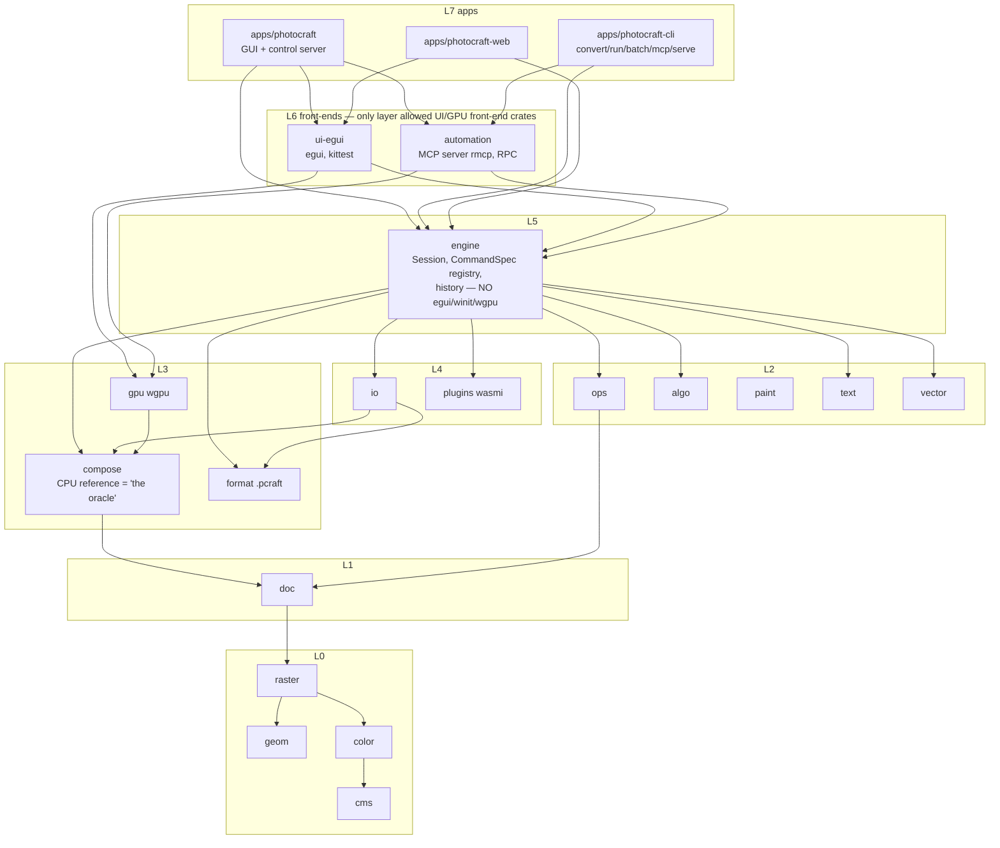

# 03 — Architecture and process reconstruction

Subject: `storytold/photocraft` ("PhotoCraft"), main pinned at `74330157cb` (2026-11-12).
Inputs: evidence files E01, E02, E03, E04, E05, E06, E07, E08 in this repo, plus spot checks in the
upstream clone (listed at the end). Every row carries a label: **VERIFIED** (seen in a primary
source and cited), **INFERRED** (reasoned from verified facts; the chain is given), **PROPOSED** (ours;
not a PhotoCraft practice). For process claims, a second tag says what kind of evidence it is:
*documented rule* (written in AGENTS.md/docs), *observed pattern* (seen in git or PR pages),
*self-reported* (a developer says so; not checked), *unknown*.

Terms used throughout:
- **AGENTS.md**: the single root agent-instruction file ("guide for AI agents and contributors",
  `HEAD:AGENTS.md:54`), 214 lines, 38 revisions (E02-002).
- **House rules**: two blocks (15 core rules plus 6 Rust rules) copied byte-for-byte from the org repo
  `storytold/craft-contrib` into `HEAD:AGENTS.md:1-52`, each with a sha256 in its header, checked by the
  `house-rules.yml` workflow (E02-012, E04-035).
- **Command registry**: the engine's table of `CommandSpec` entries; every user-visible action is one
  command with a string id and JSON params (E04-010).
- **Control channel**: a JSON protocol on a running app (`photocraft --control`) for inspecting UI state,
  injecting input and taking screenshots (`docs/control-protocol.md`, E04-013).
- **xtask**: the workspace's Rust task runner (`cargo xtask <cmd>`), 15 subcommands (E04-030).
- **`panic_hunt`**: an integration test that enumerates every registered command and fuzzes it with
  hostile params; a panic fails the gate (E04-012).
- **Scorecard**: `scorecard/*.toml` goal rows rendered by `cargo xtask scorecard` into `docs/scorecard.md`;
  CI fails if the rendered doc is stale (E04-050).
- **Parity checklist / FLOOR**: a generated list of the reference app's menu items and whether a command
  backs each; `FLOOR` is a constant the live count may never fall below (E01-015, E04-042).
- **Integration batch**: a branch that merges many open PRs, fixes the union, runs CI once, and is then
  either thrown away (members merged one by one) or merged as one merge commit (E06-021, E06-022).
- **Oracle**: an external source of "correct" output — here mainly Photoshop's own merged composite
  embedded in PSD files, and a CPU reference compositor for the GPU path (E04-036, E04-037).

Dates are 2026 unless stated. "Day 1" = 2026-09-30, the date of `16941f7198` ("one-shot").

---

## Summary of findings

1. **The agent-facing architecture was planned before code and landed in the first code commit.** The
   headless engine, the command registry, the control channel with `ui.screenshot`, the layer linter in
   CI and an AGENTS.md telling agents to "Launch the app with `--control`, drive it, take
   `ui.screenshot`, and look at the PNG" all exist in `16941f7198` (E04-020, E01-003). VERIFIED.
2. **Only four mechanisms are *documented* as aids for agents developing the product:** the
   screenshot/offscreen self-check, the ranked machine-readable work lists (scorecard, gaps.md, parity
   checklist), the per-agent target directory rules, and the mechanical gates named in AGENTS.md's
   "Before you finish" list. MCP, the CLI and `serve` are documented for agents *using* the product, not
   for agents building it (E04-018, E04-026). VERIFIED.
3. **Rules that matter became checks, usually after a failure.** `panic_hunt` ran in CI only after a commit
   noted nothing enforced the "must stay green" rule (45afd2e9d7); the GPU no-skip check came after 57 GPU
   tests "passed without comparing anything" (2ff8f419cb); "everything is a command" got a lexical
   scanner (4165c57f92). Rules with no check (licence allowlist, "no agent attribution", claim-before-coding)
   are the ones practice visibly diverges from (E02 §4, E05-071). VERIFIED.
4. **The process is a high-throughput, weak-review pipeline held together by gates and integrators.**
   ~3,285 PRs landed in 44 days (E03 §5); on 10 sampled PR pages, human approval appears once (#7848)
   and "No reviews" is common (E06-040/041, E05-035). From late October most community PRs reached main
   through maintainer-run integration batches; one batch PR states review was done by "two independent
   agents per PR (a reviewer and an attacker)" (#9386, via WebFetch summary). VERIFIED (sample) / INFERRED
   (generalisation).
5. **The orchestration layer is invisible.** No subagent, orchestration, worktree or tool-permission
   configuration exists on main; session memory lives in a gitignored `log/devlog.md`; the original plan
   lives in a gitignored `plan/` (E02 §6, E01-005). How many agents ran, how they were launched and how work
   was assigned is only self-reported ("8 parallel agents", "10–20 concurrent agents", E08-003/005).

---

# Part A — Architecture as it bears on agent development

## A.0 How to read the verdict columns

For each mechanism we give three answers:
- **Documented as aiding agent development?** — a primary doc tells a developer or agent to use it while
  building or testing PhotoCraft. Quoted when yes.
- **Observed used that way in history?** — commits, tests or PR pages show it used during development.
- **Only our hypothesis?** — the link to agent development is ours, not the project's.

Agent use counts only when explicitly attributed (trailer, identity, branch name, PR footer). Many
infrastructure commits (`16941f7198`, `0f955e6c82`, `968baf639e`) carry no trailer: their authorship
by an agent is *unknown* (E04 open questions).

## A.1 Dependency-layer diagram

Source: `xtask/src/layers.rs` TABLE (`HEAD:xtask/src/layers.rs:35-75`) and the direct-dependency scan in
E04-002. Every edge points downward; UI crates (`egui`, `eframe`, `winit`, `rfd`, …) are banned below
layer 6 (`HEAD:xtask/src/layers.rs:102`, `UI_MIN_LAYER = 6` at `:105`). VERIFIED.



Simplified: edges are a subset of E04-002's table; standalone crates (`codecs`, `affinity`, `raw`,
`ipp`, `tablet`) and the dev-only `testkit` are omitted. Note the deviation from the day-1 plan: the
engine does not depend on `gpu` at all, whereas the plan made `gpu` an optional default engine feature
(`16941f7198:docs/architecture.md`, still at `HEAD:docs/architecture.md:184`; E04-002). VERIFIED.

## A.2 "One command, four front-ends" diagram

Sources: `HEAD:crates/engine/src/cmd.rs:14-28` (struct), `HEAD:crates/engine/src/session/execute.rs:17`
(single dispatch), `HEAD:AGENTS.md:116` (rule 1), E04-011/012/016. VERIFIED.

```mermaid
flowchart LR
  subgraph Registry[engine: CommandSpec registry ~805 ids at HEAD, regex estimate]
    SPEC["CommandSpec { id, label, menu, shortcut,<br/>params: &'static str (JSON-ish doc),<br/>enabled, run: fn(&mut Session,&Value)->Result<Value>, journal }"]
  end
  EXEC["Session::execute(id, params: Value) -> Result<Value><br/>one history step per run; 'coalesce' param"]
  SPEC --> EXEC
  UI[GUI panels / menus<br/>ui-egui] -- "dispatch by id<br/>(checked by xtask panel-commands)" --> EXEC
  CLIF[CLI: photocraft-cli run / batch / serve] --> EXEC
  CTRL[Control channel: engine.execute,<br/>engine.commands, ui.* methods] --> EXEC
  MCP[MCP server: command_list / command_run<br/>+ 24 doc/ui/job tools] --> EXEC
  TEST[Tests: Session::new() + execute;<br/>panic_hunt enumerates command_specs()] --> EXEC
```

The fifth consumer, tests, is named by the architecture principle itself: "Every feature is reachable
without a GUI: from tests, the CLI and MCP. The GUI is one client of the engine."
(`16941f7198:docs/architecture.md:23`, unchanged at `HEAD:docs/architecture.md:52`; E04-008). VERIFIED.

## A.3 Mechanism by mechanism

### A.3.1 Headless engine

- **Exists:** VERIFIED. `crates/engine` has no egui, eframe, winit, wgpu or rfd dependency
  (`HEAD:crates/engine/Cargo.toml`; E04-007). The layer linter makes this a CI failure, not a convention
  (`HEAD:xtask/src/layers.rs:102`).
- **Since:** day 1, `16941f7198` (E04-005: `engine` among the 14 initial crates).
- **How it works:** a `Session` owns documents and history; all work goes through
  `Session::execute(id, params)` (`HEAD:crates/engine/src/session/execute.rs:17`) or the undoable
  `Session::edit` (`:232`). Tests construct `Session::new()` directly — 135 files under
  `crates/engine/tests` do so (E04-008). `photocraft-cli serve` keeps "one headless engine session … the
  fastest way for a script or agent to make many edits" (`HEAD:docs/control-protocol.md:473-490`), and MCP
  has a headless in-process mode with "no window" (`:383`; E04-009). The engine also compiles to wasm
  (`HEAD:AGENTS.md:122`, rule 7), checked by `cargo xtask wasm` in the gate.

| Documented as aiding agent dev? | Observed used that way? | Only our hypothesis? |
|---|---|---|
| Partly. The principle names **tests** as a client ("reachable without a GUI: from tests, the CLI and MCP", `HEAD:docs/architecture.md:52`). It never says "so that agents can develop it". | Yes for testing: 4,452 engine test attributes, tests drive `Session::new()` (E04-004, E04-008). Agent authorship of those tests is per-commit (unknown for many). | "Headless was chosen *to make agent development easier*" is our hypothesis. The documented reason is testability and multiple clients. |

### A.3.2 Layered workspace with CI-enforced dependency direction

- **Exists:** VERIFIED. 24 crates + 4 apps + xtask (`HEAD:Cargo.toml:3`; E04-001). `cargo xtask layers`
  parses `cargo metadata`, rejects upward edges, UI crates below L6, a non-dev use of `testkit`, and any
  crate not registered in the TABLE (`HEAD:xtask/src/layers.rs`, 396 lines, unit tests at `:266-380`;
  E04-031).
- **Since:** day 1, and in CI on day 1 (`16941f7198:.github/workflows/ci.yml:60-61`; E04-031).
- **How it works:** a static TABLE maps crate → layer; intra-layer order is allowed only for named pairs
  (`INTRA_LAYER_ORDER`, `:80`); `STANDALONE_EXCEPTIONS` is empty (`:93`). It runs inside
  `cargo xtask ci` and in the Windows integration leg (E04-030). AGENTS.md: "**Layering is enforced** by
  `cargo xtask layers`. A crate may depend only on lower layers. … A new crate must be registered in
  `xtask/src/layers.rs`." (`HEAD:AGENTS.md:77-99`; E02 §2.3).
- **Drift:** the TABLE still reserves never-built crates (`tools`, `viewport`, `ml`, `platform`,
  `adobe-assets`), and AGENTS.md §2 still lists `psd` after its removal in `74330157cb` (E04-006, E04-031).

| Documented as aiding agent dev? | Observed used that way? | Only our hypothesis? |
|---|---|---|
| Yes, as an instruction to agents: listed in "Before you finish a task" from day 1 (`16941f7198:AGENTS.md:49-54`) and at HEAD (`HEAD:AGENTS.md:145-160`). The *purpose* given is architecture integrity, not agent support. | Yes: blocking CI gate since day 1 (E04-031, E05 §0.2). | That it was designed because agents erode architecture is our hypothesis. |

### A.3.3 Single command registry (JSON in/out) feeding UI, CLI, control channel and MCP

- **Exists:** VERIFIED. `pub struct CommandSpec` (`HEAD:crates/engine/src/cmd.rs:15`) with `params:
  &'static str` described as a "Human/agent-readable parameter description (JSON-ish)" (`:22-23`) and
  `run: fn(&mut Session,&Value)->Result<Value>`. Same shape in the one-shot
  (`16941f7198:crates/engine/src/commands.rs:16-30`; E04-010).
- **Since:** day 1. ~76 command ids at `16941f7198`, ~805 at HEAD (regex upper-bound estimate, E04-010;
  docs say "~700", README "500+" — doc drift). Spread over 195 files in `crates/engine/src/cmd/`.
- **How it works:** one dispatch function, JSON value in and out, one history step per run
  (`HEAD:docs/contributing.md:18-22`). The params doc string "is what agents read through `commands` /
  `command_list`" (E04-011). MCP wraps the registry generically (`command_list`/`command_run`), so new
  commands reach MCP with no new tool code (E04-016). `panic_hunt` enumerates `command_specs()` and
  fuzzes each (`HEAD:crates/engine/tests/panic_hunt.rs:1-5`). AGENTS.md rule 1: "**Everything is a
  command.** … The UI, CLI, control channel and MCP all dispatch commands by id." (`HEAD:AGENTS.md:116`).
  AGENTS.md §6 tells parallel agents to put new commands in a **new module** with a `specs()` function
  "rather than growing a shared file" (`HEAD:AGENTS.md:173`).

| Documented as aiding agent dev? | Observed used that way? | Only our hypothesis? |
|---|---|---|
| Yes in two ways: (a) the params string is called "agent-readable" (`cmd.rs:22-23`); (b) the new-module-per-area rule is in the **Parallel agents** section (`HEAD:AGENTS.md:173`). | Yes: `panic_hunt` (added bf111b524e, Claude Opus 4.8 trailer) fuzzes every command in the CI gate (E04-012); conflict-avoidance via per-area modules is implied by 195 command files (count only). | That the registry shape *reduced merge conflicts between agents* is our INFERENCE from the §6 rule; not measured. |

### A.3.4 Control channel / CLI / MCP programmatic interfaces

- **Exists:** VERIFIED.
  - Control channel: 14 methods on day 1 (`engine.execute`, `engine.commands`, `ui.inspect`, `ui.set`,
    `ui.menu.*`, `ui.dialog.*`, `ui.pointer`, `ui.screenshot`, …; `16941f7198:docs/control-protocol.md:20-33`).
    At HEAD the doc is 840 lines with token/HMAC auth, jobs, an MCP bridge and a headless server
    (`HEAD:docs/control-protocol.md:11-40`, `:379`, `:473`; E04-013). Transport
    `apps/photocraft/src/control_server.rs`, handlers `crates/ui-egui/src/control.rs`.
  - Offscreen path: `crates/ui-egui/examples/snapshot.rs` replays "a JSON array of `[method, params]`
    control-protocol calls" with no window (since ae92ac20bf; E04-021).
  - CLI: 8 subcommands (`HEAD:apps/photocraft-cli/src/args.rs:33-40`; E04-014).
  - MCP: `crates/automation/src/server.rs`, 17 tools on day 1 (ae92ac20bf) → 26 at HEAD; bridge mode
    forwards to a live `photocraft --control` "so agents see and drive the live app"
    (`HEAD:docs/control-protocol.md:384`; E04-016/017).
- **Since:** control channel and CLI day 1 (`16941f7198`); MCP day 1 afternoon (`ae92ac20bf`); docs/mcp.md
  2026-10-09 (`15e35cf605`).
- **How it works for development:** AGENTS.md rule 6 at HEAD: "**Verify UI changes visually.** Render
  offscreen with `cargo run -p photocraft-ui-egui --example snapshot` (no window, no focus stealing), or
  launch with `--control` and take `ui.screenshot`. Look at the PNG." (`HEAD:AGENTS.md:121`). The same
  `control::handle` call drives egui_kittest UI tests: 32 files under `crates/ui-egui/tests` and 71
  `*tests*.rs` files in `src` (E04-023). MCP has its own acceptance test, "an agent completes 10 scripted
  edit tasks over MCP" (`HEAD:crates/automation/tests/it/agent_tasks.rs:1-4`; E04-026).

| Interface | Documented as aiding agent dev? | Observed used that way? | Only our hypothesis? |
|---|---|---|---|
| Control channel `--control` + `ui.screenshot` | **Yes, verbatim, since day 1:** "Launch the app with `--control`, drive it, take `ui.screenshot`, and look at the PNG." (`16941f7198:AGENTS.md:44`) | Yes: PR #7374 (`claude/github-issue-7342-dfa793`, "Generated with Claude Code") — "checked in the running app through the control channel (`ui.pointer` … then `ui.screenshot`)" (via WebFetch summary, E04-024). Frequency unknown: only 1 PR sampled. | — |
| Offscreen `snapshot` example | Yes: `HEAD:AGENTS.md:121`; `HEAD:docs/contributing.md:13` "Verify visually (offscreen `snapshot` example or the control channel) before submitting" | Yes, a few commit-level traces: c080ed3e72 "Snapshot-verified." (Claude Opus 4.8 trailer), d59d2b509f, e4bc5c25e8; only 3 messages match the phrase across 12,396 commits (E04-024) | — |
| Control protocol inside UI tests | Partly: "screenshot checks through the control channel" (`HEAD:docs/development.md:469`) | Yes: 32 + 71 test files (E04-023) | — |
| CLI | Partly (PSD write recipes in development.md) | Manual only: `xtask psd-write-oracle` drives the CLI; CI does not run it (E04-041) | — |
| MCP | **No** for dev agents; documented for end-user agents (`docs/mcp.md:25` `claude mcp add photocraft …`; README "Built for agents", `HEAD:README.md:228-249`) | Only as product acceptance tests (`agent_tasks.rs`); no evidence dev agents check their own work over MCP (E04-026) | "MCP helps agents build PhotoCraft" would be our hypothesis — not supported |

### A.3.5 Deterministic testing (testkit, software-GPU parity, fail-on-skip)

- **Exists:** VERIFIED.
  - `crates/testkit` (10-line lib, 356 lines total): `gpu_lock` to serialise wgpu tests ("drivers crash
    under parallel devices"), a perf sampler, and `Sweep`, which slices long sweeps by UTC date so "every
    case runs at least once every `parts` days"; `PHOTOCRAFT_FULL_SWEEP=1` runs all
    (`HEAD:crates/testkit/src/lib.rs`, `crates/testkit/src/sweep.rs:1-20`; E04-027, E05-021).
  - Headless UI tests via `egui_kittest` (822 `Harness::` uses); no golden images: "pixel appearance is
    reviewed from the saved images rather than a golden-image test" (`HEAD:docs/development.md:93`; E04-028).
  - CPU-vs-GPU parity: `crates/gpu/tests/it/parity.rs`, 78 tests, "must match the reference compositor
    within 2/255" (E04-037).
  - Software GPU + fail-on-skip: `scripts/ci-gpu-lavapipe.py` re-runs the nextest `gpu` group on Mesa
    lavapipe and fails on authored "skipping"/"no adapter" lines or a missing "GPU parity backend: Vulkan"
    line (`HEAD:scripts/ci-gpu-lavapipe.py:21-37`; in the gate command at `HEAD:.github/workflows/ci.yml:172`).
  - Determinism rules: seeded randomness (`HEAD:docs/contributing.md:17`), noise hashed from document
    coordinates (`HEAD:docs/architecture.md:57`), GPU tests capped at 4 threads (`.config/nextest.toml`).
  - No retries or quarantine at HEAD; a retry profile was tried (110d58bea9) and dropped in integration
    (8f58ea4629; E05-050).
- **Since:** testkit stub day 1; parity tests `ae92ac20bf` (day 1); gpu test group 3092d3b6f9 (10-10);
  lavapipe no-skip 2ff8f419cb (11-06).
- **Trigger for fail-on-skip:** "the GPU tests ran on Mesa llvmpipe over GL, which can't render
  Rgba32Float: 57 GPU checks … returned early and passed without comparing anything." (2ff8f419cb; E05-024).

| Documented as aiding agent dev? | Observed used that way? | Only our hypothesis? |
|---|---|---|
| No agent framing. Documented as CI determinism / honesty ("Report only what ran", `HEAD:AGENTS.md:12`; "No speedup should be claimed from … omitting tests", `HEAD:docs/development.md:84`). | Yes as a gate; the vacuous-test failure it fixes is a recurring class (E07-018: six cases incl. "checked nothing", "asserted nothing"). | That vacuous tests are an *agent* failure mode is our hypothesis; commit texts never blame agents (E05-073). |

### A.3.6 Reference oracles and pinned corpora with ratcheting floors

- **Exists:** VERIFIED.
  - 10 sha256 manifests in `xtask/*.sha256`, 1,044 files (photoshop 258, psd-tools 309, psd 170,
    pngsuite 178, affinity 60, gimp 28, atn 16, pixls 11, heif 9, exr 5); fetched and verified by
    `cargo xtask corpus`; tested by `cargo xtask test-corpus`; CI `corpus` job on every PR, "a missing
    corpus fails the tests" (E04-036, E05-025).
  - Oracle: "PSD files contain Photoshop's own merged composite … a free, large conformance test suite"
    (`HEAD:docs/architecture.md:356-358`); PASS ≤ 2/255 (`HEAD:docs/development.md:1132-1145`).
  - Ratchets: corpus floors "never lower them"; "Moving a pin: … adjust floors only upwards"
    (`xtask/src/corpus_pins.rs:9-10`); parity `FLOOR = 663` (`HEAD:crates/ui-egui/src/menus/parity.rs:10`).
  - PSD write oracle: "Execute small PSD export recipes with the headless CLI. Photoshop is a separate
    judge." (`xtask/src/psd_write_oracle.rs:1`, f54d605e2c, 11-05); manual, not in CI (E04-041).
- **Since:** corpora 968baf639e (10-05, #190); last manifest pngsuite 9163afbdcf (10-12); GPU parity day 1.
- **How it works:** the oracle is external, so an agent cannot "fix" a test by editing an expected
  value: the expected image comes from the reference app's file. Floors only move up, so coverage cannot
  silently regress.

| Documented as aiding agent dev? | Observed used that way? | Only our hypothesis? |
|---|---|---|
| Instructed to agents: AGENTS.md rule 4 "Keep the PSD corpus results and the parity floor … from r[egressing]" and `test-corpus` in "Before you finish" when io/codecs/compose/gpu change (`HEAD:AGENTS.md:119`, `:145-160`; E05-015). Purpose stated as correctness, not agent support. | Yes: CI job every PR; floors raised in commits ("Parity 608 -> 609; FLOOR 604. Snapshot-verified.", c080ed3e72, Claude Opus 4.8 trailer). | That an external oracle is *specifically* a defence against agents gaming tests is our INFERENCE (expected values are not in the editable code). |

### A.3.7 Architecture checks

| Check | What it enforces | Since | In CI? | Documented to agents? | Source |
|---|---|---|---|---|---|
| `xtask layers` | dependency direction; UI-crate ban below L6 | `16941f7198` (09-30) | yes, gate | yes, AGENTS.md §2/§5 | E04-031 |
| `xtask panel-commands` | UI click handlers must dispatch command ids; allowlist "only shrinks" (1 entry at HEAD) | `4165c57f92` (10-11, David Mann, Claude Opus 5.5 (1M context) trailer) | yes, gate | yes, finish list | `HEAD:xtask/src/panel_commands.rs:1-28`; E04-012 |
| `panic_hunt` | no command panics on hostile params | test bf111b524e (10-04); in CI only from 45afd2e9d7 (10-17) | yes, gate | yes, rule 9 (`HEAD:AGENTS.md:125`) | E04-012, E05-071 |
| Workspace lints + `clippy.toml` | `unsafe_code = "forbid"`, unwrap/expect/panic only in tests, `cognitive-complexity-threshold = 30`, ban `egui::ComboBox` | clippy.toml 50a27e6c74 (10-04, #33); deny lints 604da9d06b (10-27) | yes (`-D warnings`) | yes, "Never crash" section | E04-032, E05-032 |
| Compile-time completeness | `.pcraft` writer destructures structs so a new field fails to compile | 536a7346fb / ae92ac20bf | yes (compile) | yes, AGENTS.md §8 | `HEAD:crates/format/src/convert.rs:236`; E04-033 |
| Git-source policy | git deps only from `github.com/storytold/`; no `.cargo` source replacement | 6401cfdbe1 (10-17, aiongg) | yes, `platforms` job | indirectly (craft-libs rule `HEAD:AGENTS.md:56`) | `HEAD:.github/workflows/ci.yml:93-127`; E04-034 |
| House-rules hash check | AGENTS.md house-rules blocks equal the craft-contrib source (sha256 in header) | 7d8648dfcb (11-06, FredApps) | on AGENTS.md/CLAUDE.md change | the blocks themselves | `HEAD:.github/workflows/house-rules.yml`; E02-012 (hashes recomputed and match). Shared workflow logic not inspected |
| Scorecard freshness | generated `docs/scorecard.md` matches its TOML sources | 0f955e6c82 (10-05) | yes, gate (`--check`) | yes, AGENTS.md §4.1 | E04-050 |
| wasm check | L0–L6 compile to wasm32 | day 1 | yes, gate | yes, rule 7 | E05 §0.2 |

Two notes. (1) The "source policy" on branch `origin/fix/sec-source-policy-scope` is **not** an
architecture check; it is the engine's runtime file-access policy for automation sessions (ed592c1005;
E04-034). (2) The licence allowlist (`HEAD:AGENTS.md:34-51`) has **no** mechanical check in this repo (no
`deny.toml` on any ref; E02 §4, E05-033). VERIFIED.

Verdict for the check family:

| Documented as aiding agent dev? | Observed used that way? | Only our hypothesis? |
|---|---|---|
| Yes as gate instructions in an agent-addressed file; one commit calls AGENTS.md text "steering rules" ("Never crash: steering rules, clippy.toml, forbid unsafe", 50a27e6c74; E02-006). | Yes, and with an explicit motive in commit text: "The full-registry fuzz (AGENTS.md Rule 9) is #[ignore]d and no workflow ran it, so nothing enforced 'must stay green'." (45afd2e9d7; E05-071). The `panel_commands.rs` doc: "The UI, CLI, control channel and MCP stay equivalent only while panels dispatch engine commands by id" (`:3-4`). | — (the "advisory rule → mechanical check" move is documented in commits, not hypothesised). |

### A.3.8 Machine-readable goals (scorecard, perf budgets, parity checklist, gaps.md)

| Artefact | Shape | Since | Gate? | Agent-facing text | Source |
|---|---|---|---|---|---|
| `scorecard/*.toml` → `docs/scorecard.md` | 8 TOML files, 166 items (113 done / 46 partial / 7 missing), each with `id`, `target`, `status`, `issue`, `note`; header "Statuses must be true on main" | 0f955e6c82 (10-05, #239/#221) | `scorecard --check` in gate | "Check `docs/scorecard.md` before picking work … Its numbers are measured; prefer them to estimates." (`HEAD:AGENTS.md:136-138`) | E04-050 |
| `perf/budgets.toml` | 88 scenarios, **0** with `enforce = true`, 5 `not_measurable`; "never invent a number for them" | 0f955e6c82 | `perf --quick` only; nightly cannot fail (baseline from another machine class) | "Before you finish": `perf --quick` for hot paths | E04-051, E05-028 |
| `docs/parity-checklist.md` + `FLOOR` | generated from `menu_catalog.rs` (reference-app menu tree) vs live registry; "664 of 664 menu items live" | `536a7346fb` as `docs/parity.md` (10-01); renamed 939c8f2c70 (10-10) | FLOOR test | "When parity rises, raise `FLOOR` … (never lower it)" (`HEAD:AGENTS.md:143`, stale path) | E01-015, E04-042 |
| `docs/gaps.md` | ranked shortfalls vs the target app with agent-hour estimates | 939c8f2c70 (10-10) | no | "This is the work list agents pick from: take the highest-ranked entry that nobody is working on" (`HEAD:docs/gaps.md:6-7`); "Hours are Opus 5.5 agent-hours, one agent working sequentially … **Human** marks what an agent can't finish alone." (`HEAD:docs/gaps.md:15-16`) | E02-007, E02-008 |

| Documented as aiding agent dev? | Observed used that way? | Only our hypothesis? |
|---|---|---|
| **Yes, most explicitly of all mechanisms** (quotes above: "the work list agents pick from"; "prefer them to estimates"). | Yes: `docs/scorecard.md` is the 3rd most-touched file on main (443 non-merge commits, E03-016); a stale row "costs someone a session: they sit down to write a test that is already there" (984bc5c715; E07-016). But fewer than 14% of code commits in any period update a tracker in the same commit, falling to 4.6% in November (E06-031/032). | — |

Perf budgets are the weak member: documented as a goal list, never enforced (0 of 88), so "documented
intent ≠ active gate". VERIFIED counts / INFERRED effect (E05-028).

## A.4 Planned on day 1 but never built, or abandoned

Source: `16941f7198:docs/architecture.md` (534 lines, "draft v1 (2026-09-30)"), compared with HEAD
(E04-003, E04-027). HEAD still contains the plan verbatim under "# Design plan (2026-09-30)" with a
preface "where the code differs, this summary wins" (`HEAD:docs/architecture.md:7-8`, `:32`).

| Planned item | Day-1 plan text | Status at HEAD | Label |
|---|---|---|---|
| Golden-image tests | "`testkit::assert_image_eq(actual, "golden/name.png", tol)`" (`16941f7198:docs/architecture.md:440`) | Not built. No `assert_image_eq`; "pixel appearance is reviewed from the saved images rather than a golden-image test" (`HEAD:docs/development.md:93`) | VERIFIED |
| `xtask bless` | "goldens regenerated by `xtask bless`" (same line) | Not built (no subcommand among 15) | VERIFIED |
| Validated command schema | §4.1 `params: serde_json::Value /* validated vs schema */` | Free-text "JSON-ish" doc string (`HEAD:crates/engine/src/cmd.rs:22-23`) | VERIFIED |
| Op-transaction undo | §6 "A command produces a Transaction of ops" | Whole-document snapshots per transaction (`HEAD:crates/ops/src/lib.rs:1-6`) | VERIFIED |
| Crates `viewport`, `tools`, `platform`, `adobe-assets` | in the 25-crate plan | never created; still reserved in the layers TABLE | VERIFIED |
| `ml` crate | — | added 620fef4291 (10-08), reverted bb39b4a8dd (10-25) | VERIFIED |
| `psd` crate | planned, built in one-shot | removed for external `craft-psd` (74330157cb, 11-12) | VERIFIED |
| wasmtime plug-ins | plan | `plugins` uses wasmi | VERIFIED |
| `gpu` as optional engine feature | §3 rule 5 | engine has no `gpu` dependency | VERIFIED |
| Roadmap timing | "**0. Skeleton** (1–2 wk)" (§15) | roadmap committed the same day claims M0–M2 done (`16941f7198:docs/roadmap.md:7-9`) | VERIFIED |
| Thread-count determinism | principle 6 "across thread counts" | no dedicated test found (not searched exhaustively) | VERIFIED absence, low confidence |

What this says about plan vs reality (INFERRED):
- **Principles survived; mechanisms that cost effort to maintain were replaced by cheaper ones.** All six
  principles (engine-first, everything-is-a-command, CPU oracle + GPU, COW tiles, determinism, enforced
  layering) are intact (`HEAD:docs/architecture.md:52-57`). The two mechanisms that were simplified
  (schema validation, op-level undo) and the one dropped (golden images) are those whose upkeep scales
  with every change: every command needs a schema, every op an inverse, every visual change a re-bless.
  Chain: same three items; simpler substitutes visible in code. Why the project chose this is not stated.
- **Plans became living docs rather than being retired**, with an explicit precedence rule ("this summary
  wins"). That keeps the history readable but leaves stale reservations in tooling (layers TABLE).
- **Doc drift is fast where docs are hand-written** (README "1,700 tests" vs 18,030 test attributes;
  AGENTS.md crate map lists `psd`; FLOOR path stale) and absent where docs are generated with `--check`
  (E04-004, E04 takeaways).

## A.5 Domain-specific vs transferable

Label: INFERRED (classification is ours; mechanism facts are cited above). The reader's target is a
Rust desktop IDE.

| Mechanism | Class | Reasoning / adaptation |
|---|---|---|
| Reference-app composites embedded in files as oracle (PSD merged image) | (i) image-editor-specific | Depends on the target format carrying the reference app's own rendering (E04-036). An IDE has no equivalent embedded output. |
| CPU reference compositor vs GPU within 2/255 | (i) specific | Pixel tolerance comparison between two renderers (E04-037). |
| lavapipe software-GPU rerun | (i) specific to GPU code | Applies only if the product has GPU paths. |
| Reference-app menu tree → generated parity checklist + FLOOR | (ii) transferable with adaptation | Adaptation: encode the reference IDE's action list (menus, keymap, inspections) as data, diff against your command registry, ratchet with a floor. The project itself demoted it as "not a measure of behaviour" (`HEAD:AGENTS.md:129-133`), so pair it with behaviour tests (E07-013). |
| Pinned, hashed corpora with up-only floors | (ii) | Adaptation: corpora of real projects/source files (parsers, indexers, refactorings) with sha256 pins and pass-count floors; "oracle" = compiler/`rust-analyzer`/reference IDE output captured offline. |
| PSD write oracle (CLI recipes, external judge) | (ii) | Adaptation: CLI-driven scenario recipes whose output is judged by an external tool (e.g. `cargo check` on refactored code). |
| Fail-on-skip for environment-dependent tests | (iii) directly transferable | Any test that can early-return when a capability is missing (E05-024). |
| Headless core, UI only at top layer | (iii) | Language/domain neutral (E04-007). |
| Layer linter over `cargo metadata` in CI | (iii) | Rust-workspace generic (E04-031). |
| Single command registry with JSON params, enumerable | (iii) | IDEs already have "actions"; making them enumerable JSON commands is neutral (E04-010). |
| `panic_hunt`: fuzz every registered command | (iii) | Follows directly from an enumerable registry (E04-012). |
| Lexical "UI must dispatch commands" check, shrink-only allowlist | (iii) | Pattern neutral; the scanner is egui-specific code (E04-012). |
| Control channel with inspect / input injection / screenshot; offscreen render replaying control scripts | (ii) | Adaptation: needs a renderer that can draw offscreen; egui made this cheap. In other toolkits the offscreen path may cost more. |
| Control protocol reused as UI test driver | (iii) | E04-023. |
| MCP wrapping the registry generically | (iii) | E04-016. |
| Scorecard TOML → generated doc with `--check` | (iii) | E04-050. |
| Perf budgets with "enforce once met" flags | (ii) | Adaptation: needs a baseline on the machine class CI actually uses; PhotoCraft's never fires (E05-028). |
| `Sweep` day-rotating test slices | (iii) | E05-021. |
| Compile-time destructuring completeness for serializers | (iii) | E04-033. |
| Git-source allowlist, house-rules hash block | (iii) | E04-034/035. |
| Per-agent `CARGO_TARGET_DIR`, atomic manifest writes | (iii) for Cargo workspaces | AGENTS.md §6 (`HEAD:AGENTS.md:172-176`). |

